# Guide: the whole project, step by step

This guide rebuilds the project from an empty Azure account to a monitored, automatically deployed ML API. Each step shows the same action **two ways, side by side**:

- **By code** (left): the command or file used in this project. It is repeatable, reviewable and easy to delete.
- **By hand** (right): the same action with clicks in the Azure portal, Azure ML studio or GitHub, with a screenshot of the real screen.

Both give the same result. Clicking through once shows where things live; the code is what makes the work repeatable.

The real outputs, errors and fixes of every command are in the [tutorial](docs/tutorial/README.md), one page per part.

> The portal moves its menus from time to time. If a button has moved, use the search bar at the top of the portal, or the search box inside the resource menu.

## The big picture

The project grows in 7 parts. Each part adds a few pieces on top of the previous one:

| Part | What it adds | Main idea |
|---|---|---|
| [0 · Prepare](#part-0--prepare-the-account-and-the-tools) | budget alert, tools, logins | never pay by surprise |
| [1 · Laptop](#part-1--model-and-api-on-the-laptop) | model, API, Docker image | make it work before paying for anything |
| [2 · Azure resources](#part-2--all-azure-resources-from-one-bicep-file) | 8 resources + 3 roles from one Bicep file | infrastructure as code |
| [3 · Serving](#part-3--serve-the-api-on-container-apps) | registry image, Container App, secret | a public HTTPS API with no password in code |
| [4 · Training](#part-4--train-in-azure-machine-learning) | data asset, cluster, job, model registry | train in the cloud for about €0 |
| [5 · CI/CD](#part-5--automate-with-github-actions-and-oidc) | CI, deploy and train workflows, OIDC | every push is tested and deployed, with no stored secret |
| [6 · Monitoring](#part-6--monitor-the-live-api) | telemetry, KQL, alert | see traffic and failures, get an email |

Every part starts with a diagram. **Coloured boxes marked NEW** are added in that part, grey boxes were built earlier, and the **blue numbers** match a table that says what each arrow sends and what it gets back.

The finished system:


## Where to start

| Starting point | Steps |
|---|---|
| Nothing yet | all steps, in order |
| **Only a container image** (laptop or Docker Hub) | 0 → 2 → 3 → 4 → 5 → 6 (→ 7 for secrets) |
| **Only code on GitHub** | 0 → 2 → 3, then 8 → 12 to train in Azure ML, then 13 → 18 to build and deploy automatically, then 19 → 21 to monitor |

Every new PowerShell terminal (code way) starts in the project folder with:

```powershell
. .\scripts\names.ps1
```

[scripts/names.ps1](scripts/names.ps1) holds every name used below (`$RG`, `$ACR`, `$KV`…).

## Safety rules (free account)

- Never click **Upgrade**, "Pay-as-you-go" or anything that asks for a card. (The portal shows an **Upgrade** button at the top of every page: it is never needed here.)
- Pick the cheapest plans: Container Registry **Basic**, Container Apps **Consumption only**, Azure ML cluster **min 0 nodes**.
- Put everything in **one resource group**, so one delete removes everything.
- Tag everything: `project`, `owner`, `env` and one `feature` tag (data, training, registry, serving, secrets, monitoring).
- Cost data arrives 8–48 hours late, so €0 in the first days is normal.

---

## Part 0 — Prepare the account and the tools


**In one sentence:** a budget alert emails before any cost grows, and the command-line tools talk to Azure and GitHub from the laptop.

### Step 0. Budget alert, tools, logins, resource providers

| | By code | By hand |
|---|---|---|
| Budget | (made in the portal in this project) | Portal → **Cost Management → Budgets** → **+ Add** → 5 USD per month → alerts at 50 %, 80 %, 100 % actual and 100 % forecast → an email address |
| Tools | `winget install -e --id Microsoft.AzureCLI` (plus Python, Git, Docker Desktop, GitHub CLI) | download the installers from their websites |
| Log in to Azure | `az login` (the password is typed in the browser only) | sign in at portal.azure.com |
| Log in to GitHub | `gh auth login` | sign in at github.com |
| Add-ons | `az extension add -n ml` · `az extension add -n containerapp` · `az bicep install` | nothing to install |
| Resource providers | `az provider register -n Microsoft.App` (and 6 more) | Portal → **Subscriptions** → the subscription → **Settings → Resource providers** → select → **Register** |

| The budget (by hand) | Resource providers (by hand) |
|---|---|
|  | 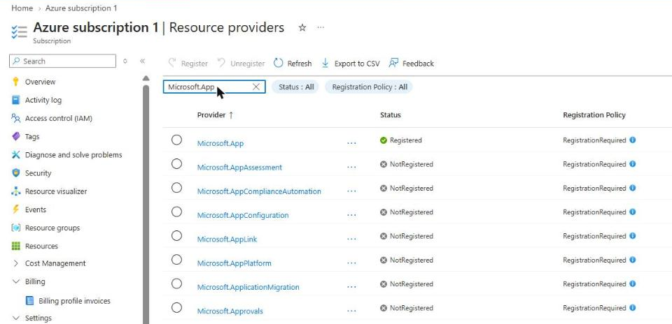 |

Details and real outputs: [Phase 0](docs/tutorial/phase_00_setup.md).

---

## Part 1 — Model and API on the laptop

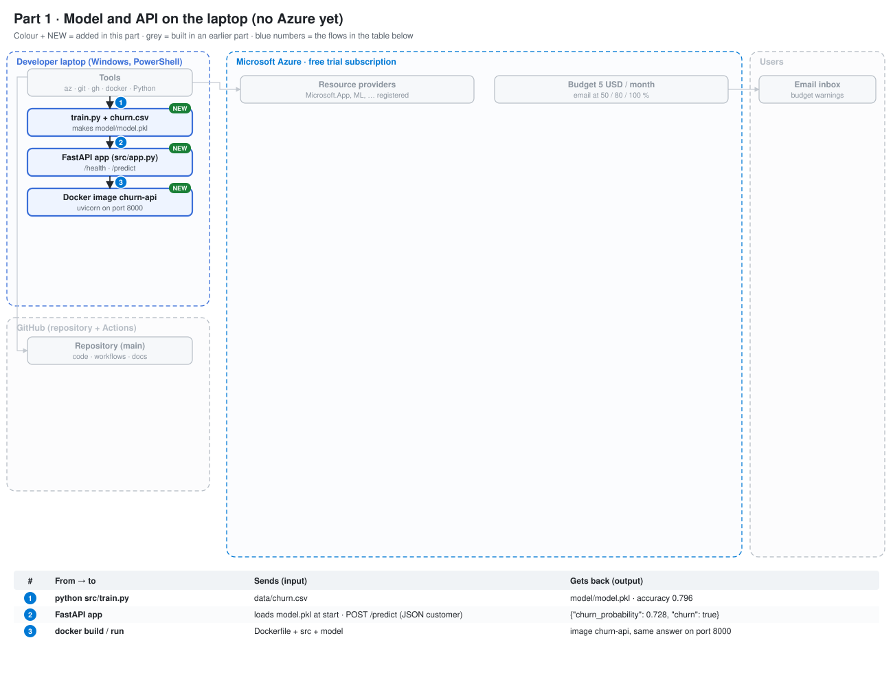

**In one sentence:** the same `train.py` that later runs in Azure is first run locally, and the API and its Docker image are tested before any cloud cost.

### Step 1. Train, serve and test locally (no Azure yet)

| | By code | Result |
|---|---|---|
| Environment | `python -m venv .venv` · `.\.venv\Scripts\Activate.ps1` · `pip install -r requirements.txt` | packages installed |
| Train | `python src/train.py` | `model/model.pkl`, accuracy 0.796 |
| Run the API | `uvicorn src.app:app --reload` | http://localhost:8000/docs |
| Test | `pytest` | 3 passed |
| Container | `docker build -t churn-api:local .` · `docker run --rm -p 8000:8000 churn-api:local` | the same API, inside Docker |

There is no "by hand" way here: this part is code only. The API's own test page:


Files: [src/train.py](src/train.py), [src/app.py](src/app.py), [tests/test_app.py](tests/test_app.py), [Dockerfile](Dockerfile). Details: [Phase 1](docs/tutorial/phase_01_laptop.md).

---

## Part 2 — All Azure resources from one Bicep file

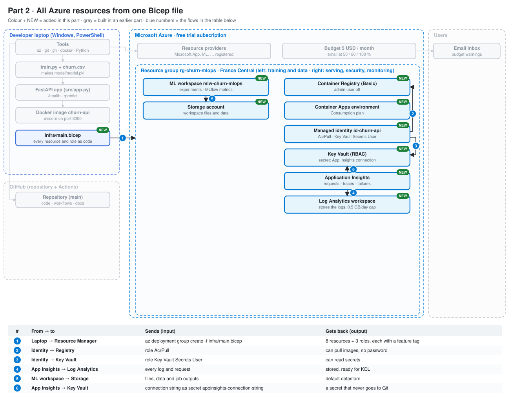

**In one sentence:** one Bicep file creates every resource and the 3 role assignments, each tagged by feature, and a free `what-if` shows the changes before anything is created.

### Step 2. Resource group

Why: one folder for every resource. It is free, and deleting it deletes everything inside.

| By code | By hand |
|---|---|
| `az group create --name $RG --location $LOCATION --tags $TAGS` | Portal → **Resource groups** → **+ Create** → name `rg-churn-mlops`, region **France Central** → **Tags** tab: `project`, `owner`, `env` → **Review + create** <br><br> 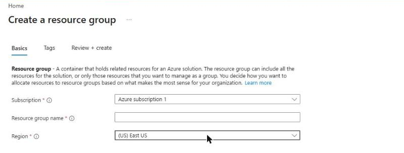 |

### Step 3. All the base resources

Why: monitoring, secrets, storage, registry, ML workspace and the serving environment, each tagged with its feature.

**By code, one file and one command:** [infra/main.bicep](infra/main.bicep) describes everything. Preview it for free, then create it:

```powershell
az deployment group what-if --resource-group $RG --template-file infra/main.bicep --parameters userObjectId=$USER_ID
```

```powershell
az deployment group create --resource-group $RG --template-file infra/main.bicep --parameters userObjectId=$USER_ID
```

(`$USER_ID = az ad signed-in-user show --query id -o tsv` comes first: the signed-in user's id, so the file can give that user the right to write secrets.)

**By hand, one resource at a time** (Portal → **Create a resource** → search the name → **Create**; pick `rg-churn-mlops` and France Central each time):

| Resource (feature tag) | Settings to choose |
|---|---|
| Log Analytics workspace (`monitoring`) | name `log-churn-mlops`; then **Usage and estimated costs → Daily cap** 0.5 GB |
| Application Insights (`monitoring`) | name `appi-churn-mlops`, resource mode workspace-based → `log-churn-mlops` |
| Key Vault (`secrets`) | name `kv-churn-ub4786`, Standard, **Access configuration: Azure role-based access control**, soft-delete 7 days |
| Storage account (`data`) | name `stchurnub4786`, Standard, LRS; **Advanced**: allow blob anonymous access **off**, minimum TLS 1.2 |
| Container Registry (`registry`) | name `acrchurnub4786`, plan **Basic**; keep **Access keys → Admin user off** |
| Azure Machine Learning (`training`) | name `mlw-churn-mlops`, pick the storage, key vault and App Insights above, container registry **None** |
| User assigned managed identity (`secrets`) | name `id-churn-api` |
| Container Apps environment (`serving`) | name `cae-churn-mlops`, plan **Consumption only**, logs → `log-churn-mlops` |

Roles (by hand: the resource → **Access control (IAM)** → **+ Add → Add role assignment**):

| Who | Role | On |
|---|---|---|
| `id-churn-api` (managed identity) | AcrPull | the registry |
| `id-churn-api` | Key Vault Secrets User | the key vault |
| the signed-in user | Key Vault Secrets Officer | the key vault (even the subscription owner cannot write secrets without it) |

| Result: the resource group | Result: the Key Vault roles (IAM → Role assignments, ids hidden) |
|---|---|
|  | 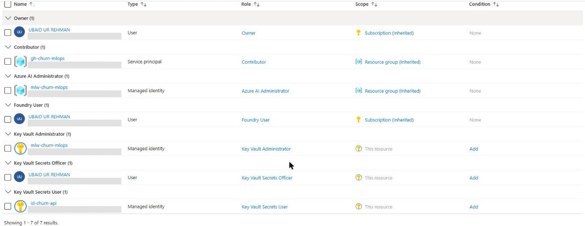 |

Details: [Phase 2](docs/tutorial/phase_02_bicep.md).

---

## Part 3 — Serve the API on Container Apps

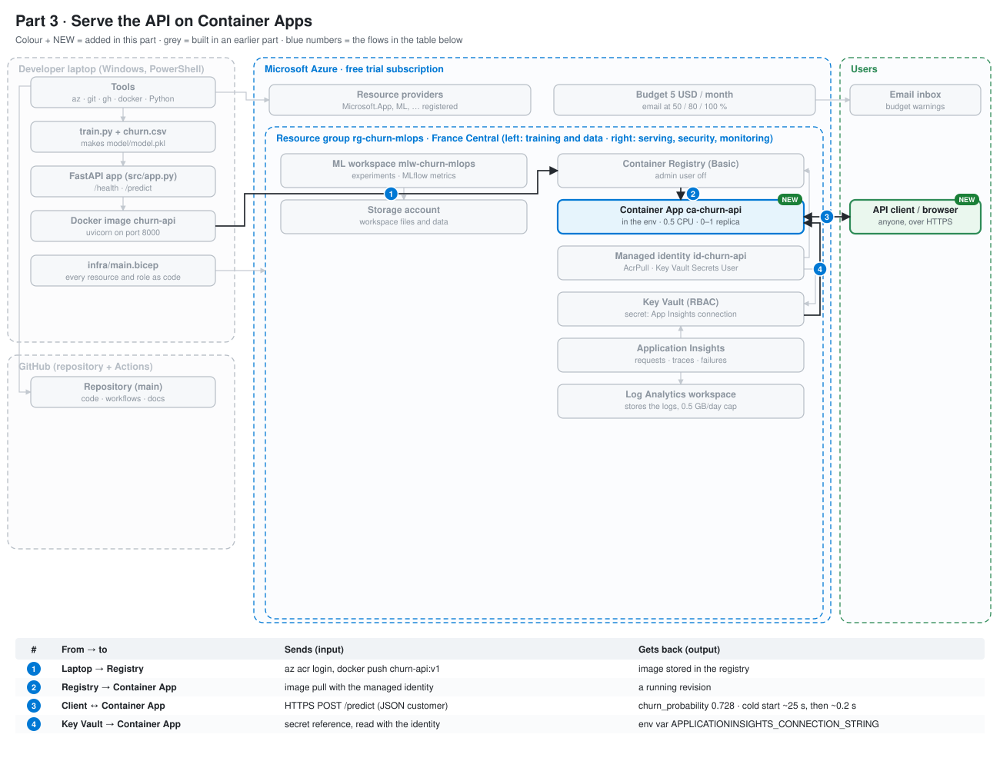

**In one sentence:** the image goes to a private registry, and the Container App pulls it with its managed identity, serves HTTPS and scales to zero when idle.

### Step 4. Put the image in the registry

If the image is **public on Docker Hub**, a Container App can pull it directly (image source "Docker Hub or other registries") and this step can be skipped. For a private image, `az acr import --name $ACR --source docker.io/<user>/<image>:<tag> --image churn-api:v1` copies it into the registry without going through the laptop.

| By code | By hand |
|---|---|
| `az acr login --name $ACR` <br> `docker build -t "${IMAGE}:v1" .` <br> `docker push "${IMAGE}:v1"` <br><br> Check: `az acr repository show-tags --name $ACR --repository churn-api -o table` | The portal has **no upload button** for images: use the code way or `az acr import`. <br> Check: registry → **Services → Repositories** → `churn-api` → its tags (`v1`, then one tag per commit from Part 5) <br><br> 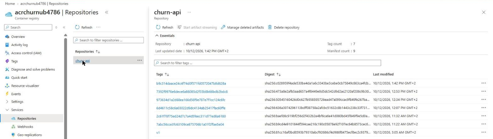 |

### Step 5. Create the Container App

Why: runs the image with a public HTTPS address, pulls it with the identity (no password), and scales to zero.

| | By code ([infra/main.bicep](infra/main.bicep), resource `app`) | By hand (Portal → **Create a resource** → **Container App**) |
|---|---|---|
| Environment | `managedEnvironmentId: cae.id` | **Basics**: environment `cae-churn-mlops` |
| Image | `image: '${acr.properties.loginServer}/churn-api:${imageTag}'` | **Container** tab: untick the quickstart image → **Azure Container Registry** → `acrchurnub4786` / `churn-api` / tag |
| Pull without password | `registries: [{ server, identity: identity.id }]` | authentication **Managed identity** → `id-churn-api` |
| Size | `cpu: 0.5`, `memory: '1Gi'` | 0.5 CPU, 1 Gi |
| Public HTTPS | `ingress: { external: true, targetPort: 8000 }` | **Ingress** tab: enabled, accepting traffic from anywhere, target port **8000** |
| Scale to zero | `scale: { minReplicas: 0, maxReplicas: 1 }` | after creation: **Application → Scale** → min 0, max 1 → **Save** |
| Address | output `apiUrl` | **Overview → Application Url** |

By code, the same `az deployment group create` as step 3 then creates or updates the app.

The same settings in the portal, on the live app:

| Container: image from the registry, pulled with the managed identity | Ingress: public HTTPS on port 8000 |
|---|---|
| 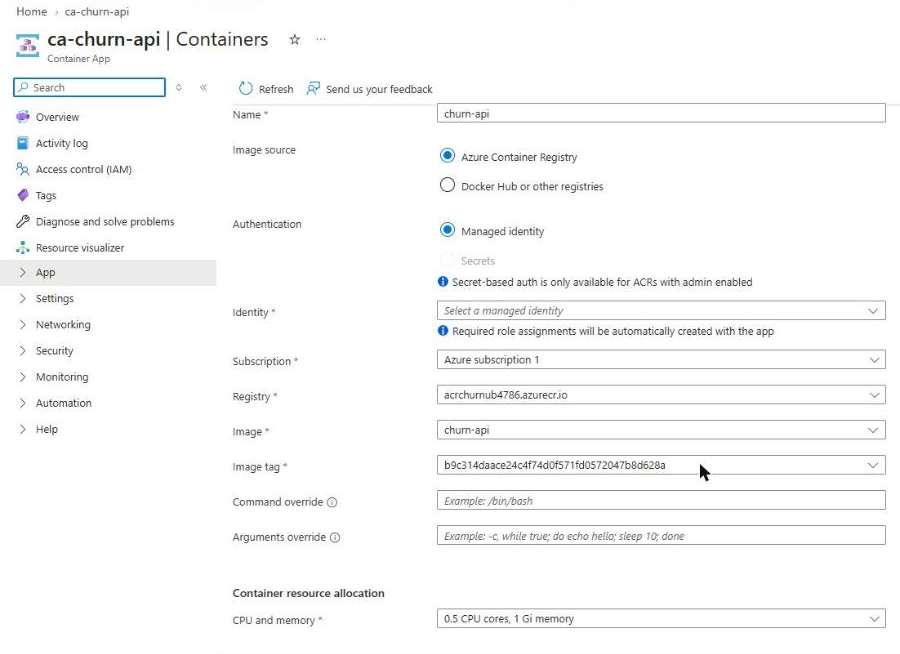 | 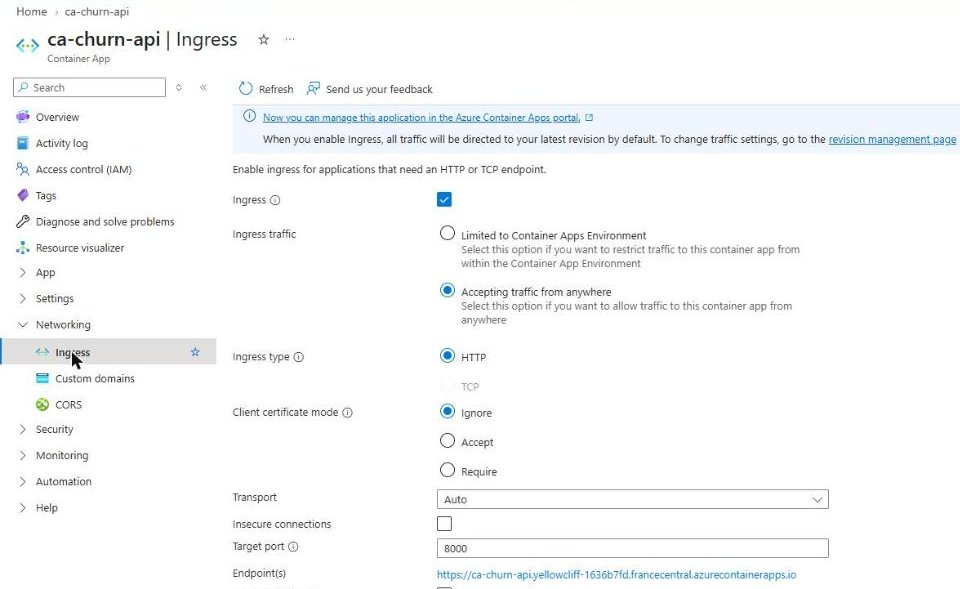 |
| **Scale: min 0, max 1 replica** | **Test: `POST /predict` on the live URL** |
| 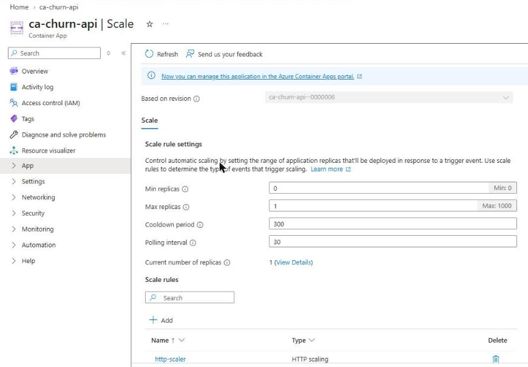 |  |

(On an existing app the portal shows the **Identity** box empty in this view; the app still pulls with `id-churn-api`, listed under **Security → Identity**.)

Test: open `<Application Url>/docs` → `POST /predict` → **0.728**, churn true. Speed: `python scripts/test_live_api.py` (cold start ~25 s, warm ~0.2 s). Details: [Phase 3](docs/tutorial/phase_03_container_apps.md).

### Step 6. Deploy a new image version

| By code | By hand |
|---|---|
| `az containerapp update --name $CA --resource-group $RG --image "${IMAGE}:<tag>"` <br><br> The [deploy workflow](.github/workflows/deploy.yml) runs this on every green push (Part 5). | Container App → **Application → Containers** → **Edit and deploy** → change the tag → **Create**. A new **revision** gets the traffic. <br> Check: **Application → Revisions and replicas** (here "Scaled to 0" because nobody is calling it) <br><br> 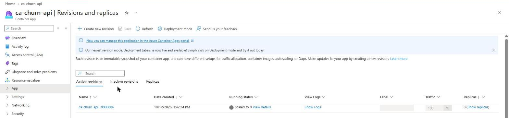 |

### Step 7. A secret from Key Vault (no secret in code)

| | By code | By hand |
|---|---|---|
| Store the secret | resource `appiSecret` in Bicep, or `az keyvault secret set --vault-name $KV --name appinsights-connection-string --value $APPI_CS --query name -o tsv` | Key Vault → **Objects → Secrets** → **+ Generate/Import** → name + value (App Insights → **Overview → Connection String**) |
| Link it to the app | `secrets: [{ name, keyVaultUrl, identity }]` in Bicep | Container App → **Security → Secrets** → **+ Add** → **Key Vault reference** → secret URL + identity |
| Give it to the code | `env: [{ name: 'APPLICATIONINSIGHTS_CONNECTION_STRING', secretRef }]` | **Containers → Environment variables** → source **Reference a secret** |

| 1. The secret in Key Vault (value never shown) |
|---|
| 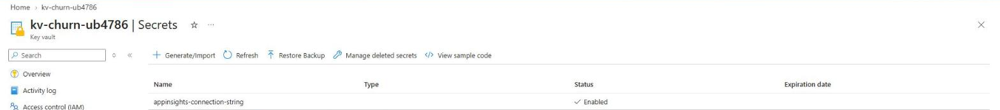 |
| **2. The app's Key Vault reference** |
| 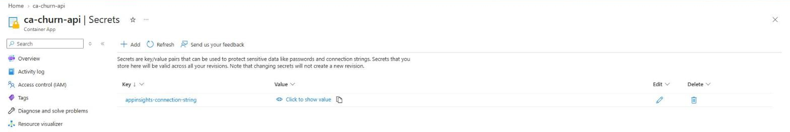 |
| **3. The environment variable that reads it** |
| 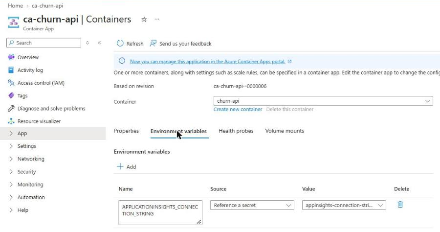 |

---

## Part 4 — Train in Azure Machine Learning


**In one sentence:** the same `train.py` runs as an Azure ML job on a cluster that exists only while it works, logs metrics with MLflow and registers the model.

Open the studio by hand: workspace → **Overview** → **Launch studio** (or https://ml.azure.com).

### Step 8. Upload the dataset

| By code | By hand |
|---|---|
| `az ml data create --name churn-data --version 1 --type uri_file --path data/churn.csv --resource-group $RG --workspace-name $AML_WORKSPACE` | Studio → **Assets → Data** → **+ Create** → name `churn-data`, type **File (uri_file)** → **From local files** → `churn.csv` → **Create** <br><br> 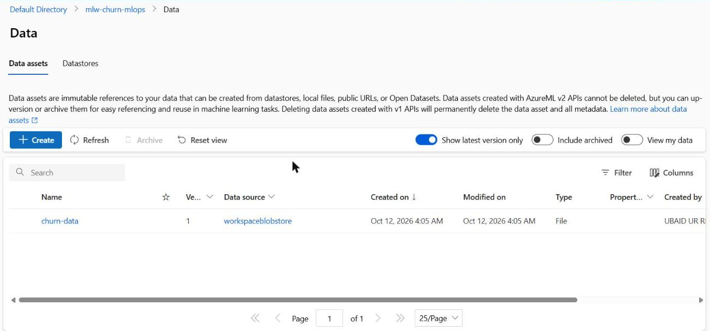 |

### Step 9. A compute cluster that costs €0 when idle

| By code | By hand |
|---|---|
| [aml/cluster.yml](aml/cluster.yml) + `az ml compute create --file aml/cluster.yml --resource-group $RG --workspace-name $AML_WORKSPACE` | Studio → **Manage → Compute → Compute clusters** → **+ New** → Dedicated, CPU, `Standard_DS11_v2` → name `cpu-cluster`, **min nodes 0**, max 1, idle seconds 120 → **Create** <br><br>  |

### Step 10. Run the training script as a job

| | By code ([aml/train-job.yml](aml/train-job.yml)) | By hand (Studio → **Jobs** → **+ Create job**, Custom) |
|---|---|---|
| Submit | `az ml job create --file aml/train-job.yml --resource-group $RG --workspace-name $AML_WORKSPACE --query name -o tsv` | **Create** at the end of the wizard |
| Code | `code: ../src` | upload the `src` folder |
| Command | `python train.py --data ${{inputs.data}} --model-dir ${{outputs.model}}` | same command |
| Input / output | `churn-data:1` / folder `model` | same |
| Environment | `azureml://registries/azureml/environments/sklearn-1.5/labels/latest` | curated **sklearn-1.5** |
| Compute | `azureml:cpu-cluster` | `cpu-cluster` |
| Watch | `az ml job stream --name $JOB …` | the job page: status, **Metrics**, **Outputs + logs** |

| The finished job | Its MLflow metrics |
|---|---|
|  |  |

Result: accuracy 0.796, F1 0.584, ROC-AUC 0.838, the same as on the laptop. Note: the model is saved with scikit-learn **1.5.2** (the version in `sklearn-1.5`), so the API pins the same version in [requirements-api.txt](requirements-api.txt). Otherwise it cannot open the model.

### Step 11. Register the model

| By code | By hand |
|---|---|
| `az ml model create --name churn-model --version 1 --type custom_model --path "azureml://jobs/$JOB/outputs/model" --resource-group $RG --workspace-name $AML_WORKSPACE` | The finished job page → **Register model** → Custom, output `model` → name `churn-model` → **Register** <br><br>  |

### Step 12. Check the cluster is back to 0 nodes

| By code | By hand |
|---|---|
| `az ml compute list-nodes --name $AML_CLUSTER --resource-group $RG --workspace-name $AML_WORKSPACE` → `[]` | Studio → **Compute → Compute clusters → cpu-cluster** → **Current node count 0** (screenshot in step 9) |

Details: [Phase 4](docs/tutorial/phase_04_azure_ml.md).

---

## Part 5 — Automate with GitHub Actions and OIDC


**In one sentence:** every push trains and tests the code; a green run builds an image with the registered model and deploys it, and GitHub logs in to Azure with a short-lived OIDC token instead of a stored secret.

### Step 13. An identity for GitHub (OIDC)

Why: GitHub gets a short-lived token per run; Azure trusts only this repo's `main` branch. No secret is stored anywhere.

| | By code | By hand |
|---|---|---|
| App | `$APP_ID = az ad app create --display-name $GH_APP --query appId -o tsv` | Portal → **Microsoft Entra ID → App registrations** → **+ New registration** → `gh-churn-mlops` |
| Service principal | `az ad sp create --id $APP_ID` | created automatically by the portal |
| Trust rule | `az ad app federated-credential create --id $APP_ID --parameters infra/github-federated-credential.json` | the app → **Certificates & secrets → Federated credentials** → **+ Add credential** → **GitHub Actions deploying Azure resources** → org, repo, entity **Branch**, `main` |


If a workflow fails with `AADSTS700213 ... subject 'repo:owner@id/repo@id:ref:refs/heads/main'`, copy that exact subject into the trust rule ([infra/github-federated-credential.json](infra/github-federated-credential.json)). GitHub now sends ids in the subject.

### Step 14. Give it a role on the resource group only

| By code | By hand |
|---|---|
| `az role assignment create --assignee-object-id $SP_ID --assignee-principal-type ServicePrincipal --role Contributor --scope $RG_ID` | Resource group → **Access control (IAM)** → **+ Add → Add role assignment** → **Contributor** → members: `gh-churn-mlops` → **Review + assign**. It then shows on every resource in the group as "Resource group (Inherited)", as in the Key Vault roles of step 3 |

### Step 15. Tell GitHub the ids (not secrets)

| By code | By hand |
|---|---|
| `gh variable set AZURE_CLIENT_ID --body $APP_ID --repo $GH_REPO` (same for `AZURE_TENANT_ID`, `AZURE_SUBSCRIPTION_ID`) | GitHub repo → **Settings → Secrets and variables → Actions → Variables** → **New repository variable** × 3 (values hidden in the screenshot) <br><br> 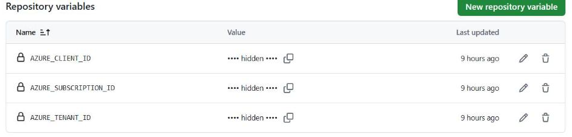 |

### Step 16. CI: train and test on every push

| By code | By hand |
|---|---|
| [.github/workflows/ci.yml](.github/workflows/ci.yml): checkout → Python 3.12 → `pip install` → `python src/train.py` → `pytest`. Starts on every `git push`. | GitHub repo → **Actions** → every run with its status; **Re-run jobs** runs one again <br><br> 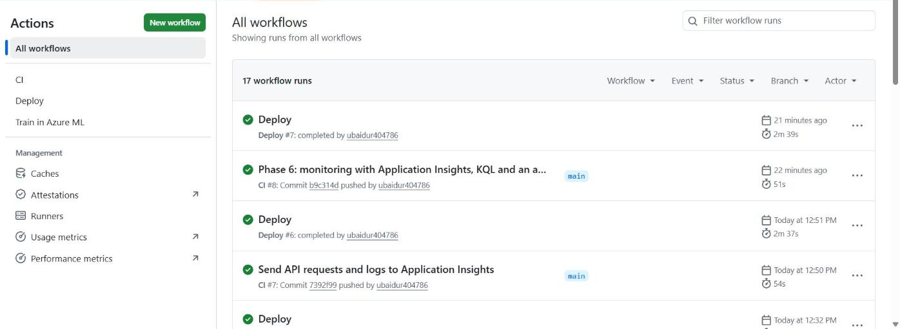 |

### Step 17. CD: build and deploy after a green CI

| By code | By hand |
|---|---|
| [.github/workflows/deploy.yml](.github/workflows/deploy.yml): OIDC login → download `churn-model:1` → `docker build` → test `/health` → `docker push` (tag = commit id) → `az containerapp update` → check the live `/health` | Container App → **Settings → Deployment** (or **Continuous deployment**) → sign in to GitHub → repo + branch `main` → registry `acrchurnub4786`, Dockerfile `./Dockerfile` → identity / OIDC → **Start**. The portal writes a simpler workflow into the repo (without our extra steps: wait for CI, add the registered model, test before push) |


### Step 18. A "Train in Azure ML" button

| By code | By hand |
|---|---|
| [.github/workflows/train.yml](.github/workflows/train.yml), started with `gh workflow run train.yml --repo $GH_REPO`; it submits [aml/train-job.yml](aml/train-job.yml) and checks the status every 30 s | GitHub → **Actions → Train in Azure ML → Run workflow** → branch `main` → **Run workflow** (or submit the job in the studio, step 10) <br><br> 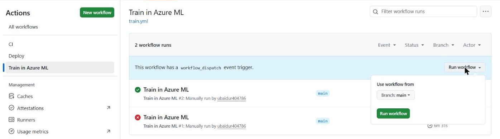 |

Details: [Phase 5](docs/tutorial/phase_05_cicd.md).

---

## Part 6 — Monitor the live API


**In one sentence:** the API sends every request and a log line per prediction to Application Insights, KQL queries turn them into traffic, failure and speed tables, and an alert emails when the server fails.

Application Insights and its Log Analytics workspace already exist (step 3), and the Container App already gets the connection string from Key Vault (step 7).

### Step 19. Send requests and logs to Application Insights

| By code | By hand |
|---|---|
| In [src/app.py](src/app.py), call `configure_azure_monitor()` **before** `from fastapi import FastAPI`, only when `APPLICATIONINSIGHTS_CONNECTION_STRING` is set. Add `azure-monitor-opentelemetry` to [requirements-api.txt](requirements-api.txt). A push and the deploy workflow ships it. | The code part has no portal button. The setting is visible in Container App → **Containers → Environment variables** (step 7). Then Application Insights → **Overview** shows requests, failures and response time a few minutes after the first calls <br><br>  |

### Step 20. Ask questions with KQL

| By code | By hand |
|---|---|
| The queries in [docs/kql/](docs/kql/requests_per_hour.kql): requests per hour, failed requests, average response time. They count with `sum(itemCount)`, because the app keeps only a sample of the requests. | Application Insights → **Monitoring → Logs** → close the welcome windows → switch **Agent** off → **KQL mode** → paste a query → **Run** <br><br>  |

### Step 21. Email when the server fails

| By code | By hand |
|---|---|
| `az monitor action-group create --resource-group $RG --name $ACTION_GROUP --short-name churnmail --action email me $EMAIL …` <br> then `az monitor metrics alert create --resource-group $RG --name $ALERT --scopes $APPI_ID --condition "count requests/failed > 5 where request/resultCode includes 500" --window-size 5m --evaluation-frequency 1m --severity 2 --action $ACTION_GROUP …` | Application Insights → **Monitoring → Alerts → + Create → Alert rule** → signal **Failed requests** → filter **Result code = 500** → Greater than 5, Count, every 1 min, lookback 5 min → **+ Create action group** → Email → the address → severity 2 → name → **Review + create** <br><br>  |

Details: [Phase 6](docs/tutorial/phase_06_monitoring.md).

---

## Cost and clean-up

| | By code | By hand |
|---|---|---|
| Credit left | — | Portal → **Subscriptions** → the subscription → **Overview** |
| Cost per service and resource | — | Portal → resource group → **Cost Management → Cost analysis** (and **Group by: Tag → feature** once the tags reach the cost data) |
| Delete everything | `az group delete --name $RG --yes` | resource group → **Delete resource group** → type the name |
| Free the Key Vault name | `az keyvault purge --name $KV` | **Key vaults → Manage deleted vaults** → **Purge** |
| Remove the Azure ML workspace for good | — | **Azure Machine Learning → Recently deleted** → delete permanently |
| Remove the GitHub identity | `az ad app delete --id $APP_ID` | **Entra ID → App registrations** → `gh-churn-mlops` → **Delete** |
| Leftover groups | `az group list -o table` | **Resource groups**: no `ME_...` or `DefaultResourceGroup-...` left |

Cost analysis of the resource group after Parts 0–6 (about €0.04 in total; the `feature` tag grouping appears once the tags reach the cost data):

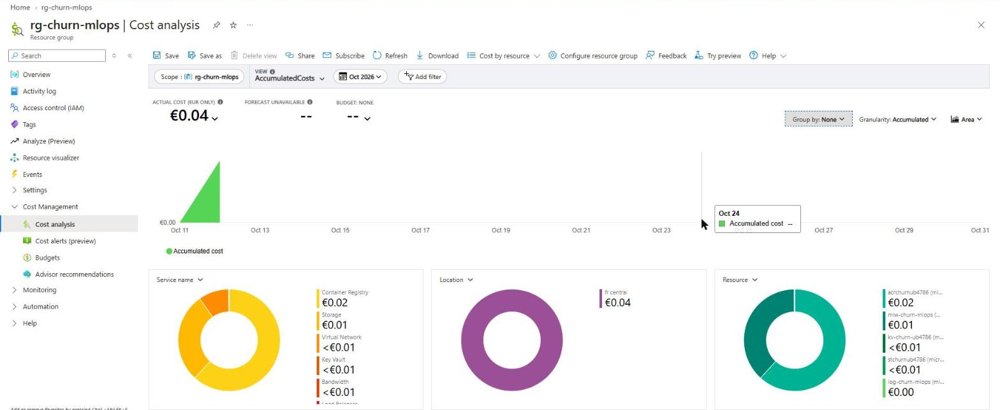
