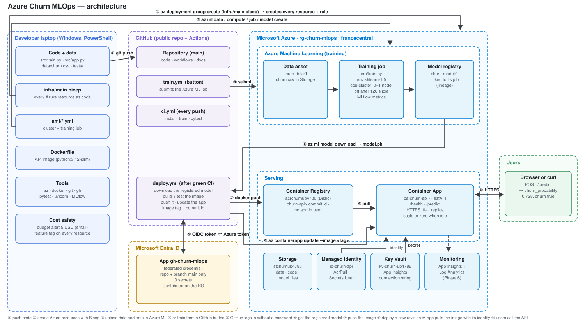
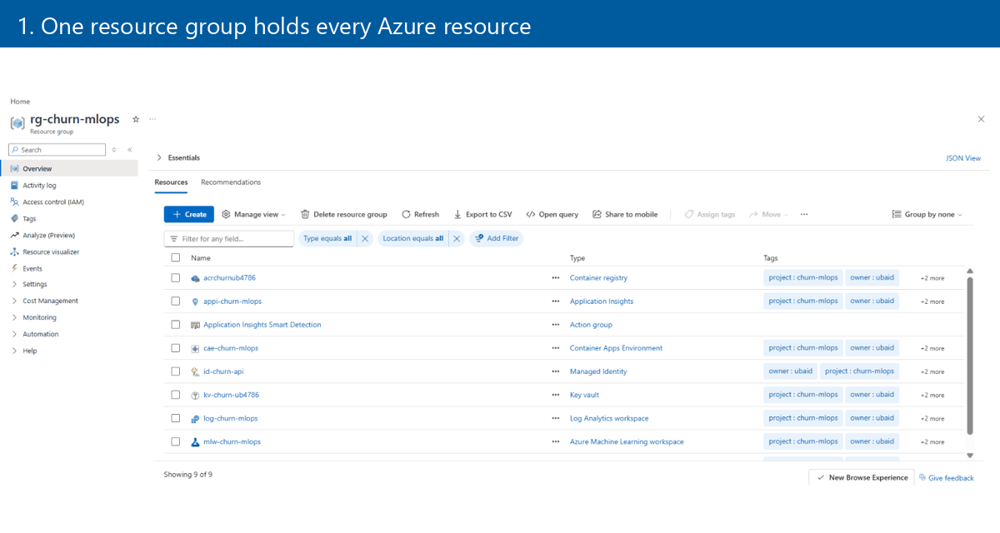
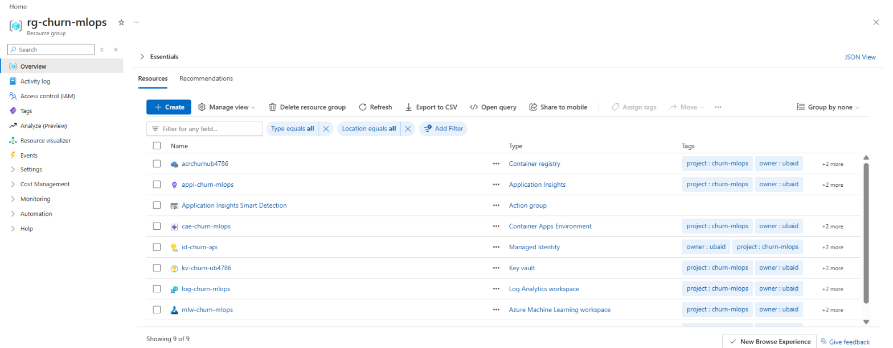
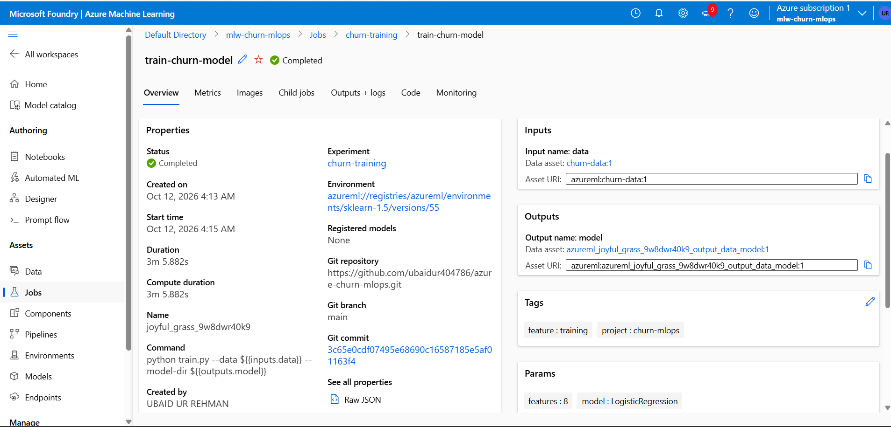
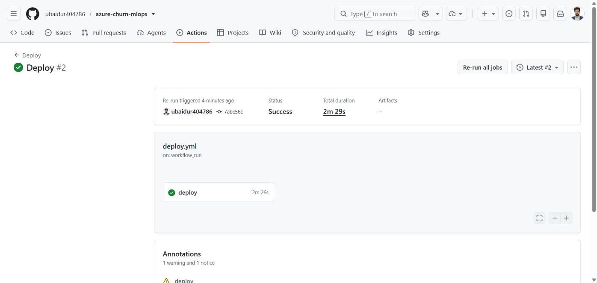
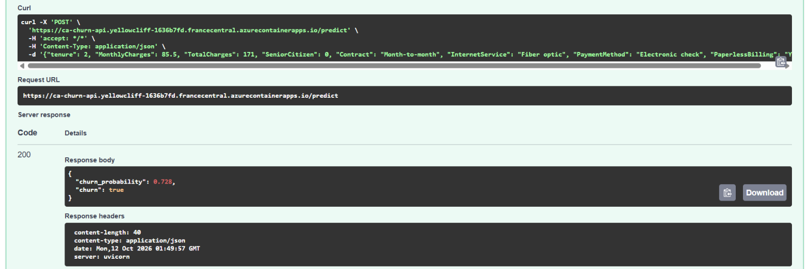
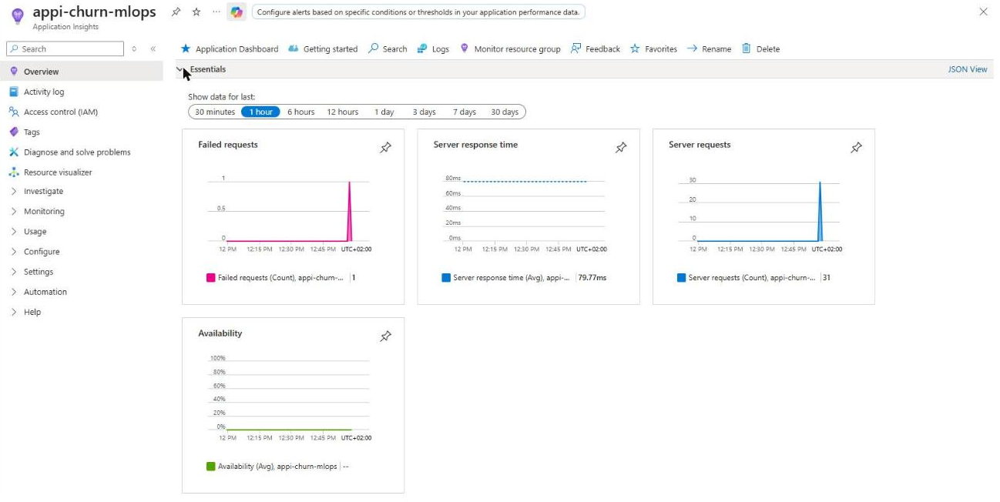
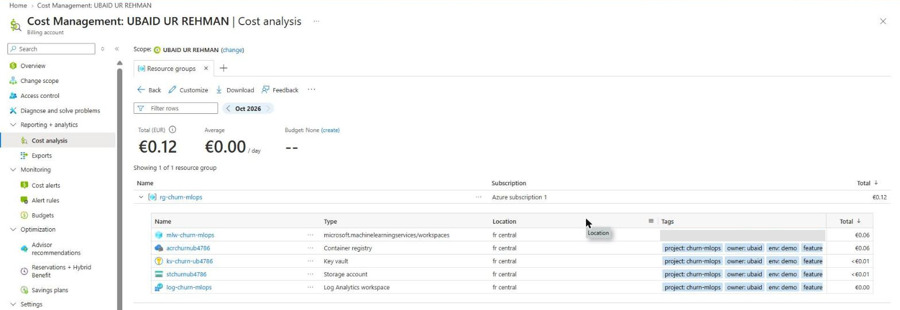

# Azure Churn MLOps

[](https://github.com/ubaidur404786/azure-churn-mlops/actions/workflows/ci.yml)

An end-to-end machine learning project on Microsoft Azure. A customer-churn model is trained in Azure Machine Learning, versioned in the model registry and served as a public HTTPS API on Azure Container Apps. The infrastructure is code (Bicep), and every change is tested and deployed by GitHub Actions, which logs in to Azure without any stored password (OIDC).

The model is deliberately simple. The focus is the cloud work around it: infrastructure as code, cloud training, deployment, security, CI/CD and cost control.



## Demo



The demo walks through the project in 10 pictures, one every 4 seconds. More about it: [docs/results/video.md](docs/results/video.md).

## What it does

- **Infrastructure as code**: one Bicep file creates every Azure resource and role, each tagged by feature for cost tracking.
- **Cloud training**: Azure ML runs the training script on a cluster that scales to 0 nodes when idle, logs metrics with MLflow and registers the model.
- **Serving**: a FastAPI app in a Docker image runs on Azure Container Apps over HTTPS, and scales to zero when nobody uses it.
- **CI/CD**: every push trains the model and runs the tests. After a green run, the registered model is packed into a new image, tagged with the commit id, and deployed.
- **Monitoring**: the API sends its requests and logs to Application Insights; saved KQL queries show traffic, failures and speed, and an alert emails when the server fails.
- **Security**: no keys or passwords in code. GitHub uses OIDC; the app uses a managed identity and Key Vault; every identity gets the smallest role it needs.
- **Cost control**: free credit only, a budget alert, scale-to-zero everywhere, and the cost of each feature measured.

## Azure services used

| Service | Why | File |
|---|---|---|
| Resource group + tags | one place for everything; tags give the cost of each feature | [scripts/names.ps1](scripts/names.ps1) |
| Bicep | creates every resource and role with one command | [infra/main.bicep](infra/main.bicep) |
| Azure Machine Learning | runs the training in the cloud, tracks metrics, stores the model | [aml/train-job.yml](aml/train-job.yml), [aml/cluster.yml](aml/cluster.yml) |
| Storage account | keeps the data and the files of Azure ML | [infra/main.bicep](infra/main.bicep) |
| Container Registry | stores the Docker image of the API | [Dockerfile](Dockerfile) |
| Container Apps | runs the API over HTTPS, scales to zero | [src/app.py](src/app.py) |
| Managed identity | lets the app pull the image and read secrets without a password | [infra/main.bicep](infra/main.bicep) |
| Key Vault | keeps the App Insights connection string out of the code | [infra/main.bicep](infra/main.bicep) |
| Entra ID + OIDC | lets GitHub Actions log in to Azure without a stored secret | [.github/workflows/deploy.yml](.github/workflows/deploy.yml) |
| Application Insights + Log Analytics | requests, logs, KQL queries and an alert | [docs/kql/](docs/kql/failed_requests.kql) |
| Cost Management | budget alert and cost per feature | [docs/cost/COST_LOG.md](docs/cost/COST_LOG.md) |

## Results

| | |
|---|---|
| Model (test set) | accuracy 0.796 · F1 0.584 · ROC-AUC 0.838, the same on the laptop and in 3 Azure ML runs |
| Live API | cold start about 25 s after scale to zero, then about 0.2–0.6 s per request |
| Pipelines | CI about 1 min · deploy about 2.5 min · cloud training about 6.5 min |
| Total Azure cost | €0.12 of the free credit (Azure ML workspace €0.06, Container Registry €0.06, the rest under €0.01) |

Details: [model metrics](docs/results/model_metrics.md) · [Azure ML runs (CSV)](docs/results/aml_runs.csv) · [API speed](docs/results/api_speed.md) · [pipeline runs](docs/results/pipeline_runs.md) · [cost log](docs/cost/COST_LOG.md).

## Screenshots

| | |
|---|---|
|  |  |
| Every resource in one group | Training job in Azure ML |
|  |  |
| GitHub Actions deploy | Live `/predict` answer |
|  |  |
| Monitoring | Real cost per resource |

All screenshots: [docs/screenshots/](docs/screenshots/).

## Deploy it in 4 commands

After `az login`, `. .\scripts\names.ps1` and `$USER_ID = az ad signed-in-user show --query id -o tsv`, plus a one-time setup: the training cluster ([aml/cluster.yml](aml/cluster.yml)), the data asset, and the GitHub login with OIDC ([infra/github-federated-credential.json](infra/github-federated-credential.json)).

```powershell
az group create --name $RG --location $LOCATION --tags $TAGS
```

```powershell
az deployment group create --resource-group $RG --template-file infra/main.bicep --parameters userObjectId=$USER_ID
```

```powershell
az ml job create --file aml/train-job.yml --resource-group $RG --workspace-name $AML_WORKSPACE
```

```powershell
git push
```

The push runs CI, then the Deploy workflow builds the image with the registered model and updates the Container App.

## How it works, step by step

1. `src/train.py` reads `data/churn.csv`, trains a logistic regression and logs the metrics with MLflow.
2. In Azure ML, the same script runs as a job on a CPU cluster (0 nodes when idle). The model is saved in the model registry as `churn-model`.
3. `src/app.py` (FastAPI) loads the model and answers `POST /predict` with a churn probability.
4. The `Dockerfile` packs the app and the model into an image, which is stored in Azure Container Registry.
5. Azure Container Apps runs the image over HTTPS. A managed identity pulls the image and reads one secret from Key Vault.
6. On every push, GitHub Actions trains and tests (`ci.yml`). If they pass, `deploy.yml` logs in with OIDC, gets the registered model, builds an image tagged with the commit id, and updates the app.
7. The app sends its requests and logs to Application Insights, which are read with KQL ([docs/kql/](docs/kql/failed_requests.kql)). An alert emails when the server fails.

## Problems solved along the way

- **Version mismatch:** the model trained in Azure ML could not be loaded by the API (different scikit-learn versions). Fixed by pinning the same versions for training and serving.
- **OIDC login failure:** GitHub changed the format of its login token subject. Fixed by trusting the exact new subject in Entra ID.
- **Sampled telemetry:** KQL `count()` showed fewer requests than really happened. Fixed with `sum(itemCount)`.

## Run it locally

```powershell
python -m venv .venv
.\.venv\Scripts\Activate.ps1
pip install -r requirements.txt
python src/train.py
uvicorn src.app:app --reload
```

Then open http://localhost:8000/docs.

> Status: the project ran live on Azure in October 2026. All the proof (screenshots, metrics, runs, cost) was captured while it was live. Shutdown is next: all Azure resources are deleted at the end of the project.
