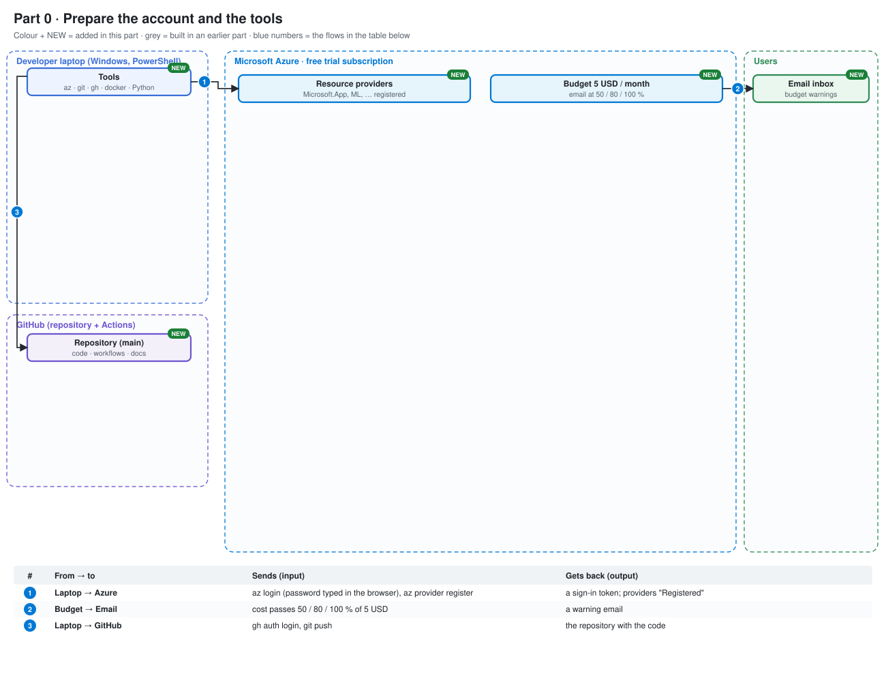
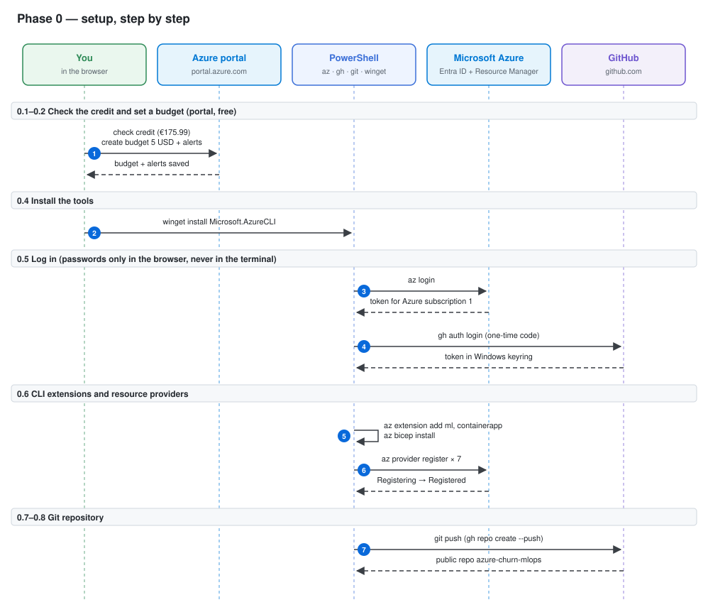
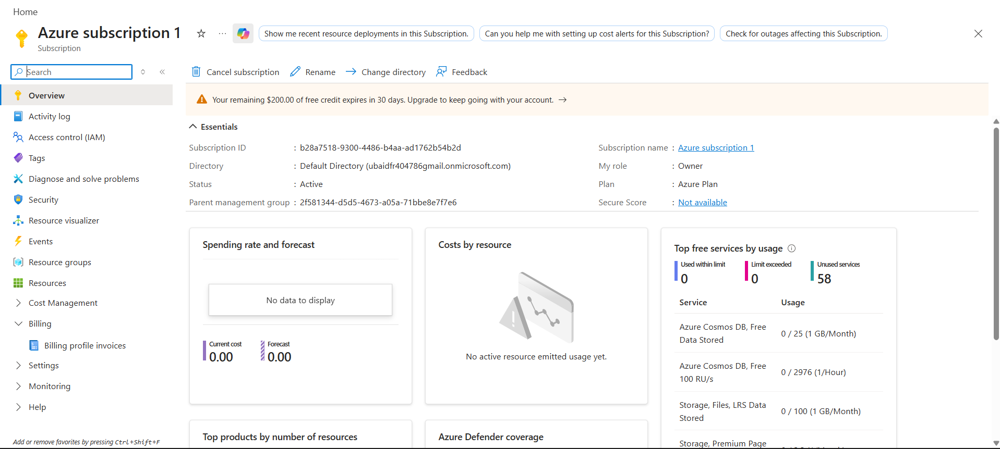
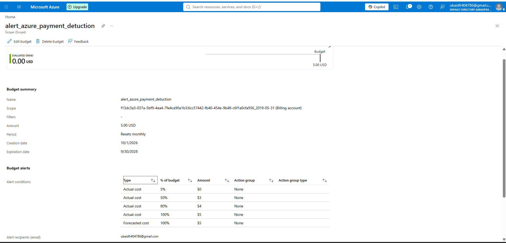

# Phase 0 — Safety, cost tracking and setup

Goal: make sure the card can never be charged, set up a budget alert, estimate the cost, install the tools, log in, and create the GitHub repository. No Azure resource is created in this phase.

---

## Where this phase fits

The system so far. Coloured boxes marked NEW are added in this phase, grey ones come from earlier phases, and the table under the picture says what each numbered arrow sends and gets back.



---

## Architecture of this phase



Read it from top to bottom. Each box at the top is a tool or a service; the dashed line under it is its timeline. Each blue number is one arrow = one call over the network (or inside the laptop). Solid arrow = a request; dashed arrow = the answer that comes back. The table below has one row per number: the command, which tool is called, what is sent and what comes back.

| # | Command | Tool called | Sends | Gets back |
|---|---|---|---|---|
| | **0.1–0.2  Check the credit and set a budget (portal, free)** | | | |
| 1 | Portal → Subscriptions; Cost Management → Budgets | browser | budget amount, alert levels 5/50/80/100 % | budget saved, alerts by email |
| | **0.4  Install the tools** | | | |
| 2 | `winget install -e --id Microsoft.AzureCLI` | winget (Windows package manager) | package id | Azure CLI 2.91 installed (open a new terminal) |
| | **0.5  Log in (passwords only in the browser, never in the terminal)** | | | |
| 3 | `az login` | az CLI → browser sign-in → Entra ID | your sign-in (typed in the browser) | access token saved in ~/.azure; subscription Enabled |
| 4 | `gh auth login` | gh CLI → browser → GitHub | one-time code | token in the Windows keyring (scopes repo, workflow) |
| | **0.6  CLI extensions and resource providers** | | | |
| 5 | `az extension add -n ml --upgrade` | az CLI | extension names | new az ml / az containerapp / az bicep commands |
| 6 | `az provider register -n <namespace>` | az CLI → Resource Manager | 7 service names (App, KeyVault, ML…) | Registering → Registered (free) |
| | **0.7–0.8  Git repository** | | | |
| 7 | `gh repo create azure-churn-mlops --public --source . --remote origin --push` | gh + git → GitHub over HTTPS | the committed files | public repo created; PLAN.md later removed with git rm --cached |

---

## 0.1 Check the subscription (portal)

Portal → Subscriptions → "Azure subscription 1".

- Plan: Azure Plan, free account, with $200 (€175.99) of credit that ends about 2026-11-10.
- The new free account has no "spending limit" switch. When the credit ends, Azure stops the resources. The card is only charged if you click "Upgrade", and we never upgrade.



---

## 0.2 Budget alert (portal)

Portal → Cost Management → Budgets → Add.

- Budget: 5 USD per month.
- Alerts by email at 5%, 50%, 80% and 100% of the real cost, plus 100% of the forecast.
- A budget does not stop anything. It only sends emails, so you see a problem early. It is free.

### Error: only one alert was saved

The first save kept only the 5% alert. Fix: open the budget again, add the other alerts, save, and check the list.



---

## 0.3 Cost estimate

[docs/cost/estimate.md](../cost/estimate.md) estimates about $1.70 for 7 days, per `feature` tag. The biggest risk is an Azure ML compute cluster left running (about $5–7 a day). That is why it always uses min 0 nodes.

---

## 0.4 Install the tools

Check which tools are installed and print their versions:

```powershell
foreach ($t in "python","git","code","docker","az","gh") { $c = Get-Command $t -ErrorAction SilentlyContinue; if ($c) { "$t : " + ((& $t --version 2>$null) | Select-Object -First 1) } else { "$t : MISSING" } }
```

```
python : Python 3.12.4
git : git version 2.55.0.windows.3
code : 1.141.0
docker : Docker version 29.0.1, build eedd969
az : MISSING
gh : gh version 2.98.0 (2026-08-20)
```

### Error: `az` is missing

The Azure CLI was not installed. Fix: install it with winget, then **open a new terminal** (the old one does not know the new program yet).

```powershell
winget install -e --id Microsoft.AzureCLI
```

```powershell
az version
```

```json
{
  "azure-cli": "2.91.0",
  "azure-cli-core": "2.91.0",
  "azure-cli-telemetry": "1.1.0",
  "extensions": {}
}
```

Meaning: the CLI works. `extensions: {}` = no extensions yet (added in 0.6).

VS Code extensions for Azure, Bicep, Docker and Python:

```powershell
code --install-extension ms-vscode.vscode-node-azure-pack --install-extension ms-azuretools.vscode-bicep --install-extension ms-azuretools.vscode-docker --install-extension ms-python.python
```

---

## 0.5 Log in to Azure and GitHub

Log in to Azure (a browser window opens; the password is typed there, never in the terminal):

```powershell
az login
```

```
Tenant: Default Directory
Subscription: Azure subscription 1 (<subscription id hidden>)
```

Check the account is active:

```powershell
az account show --query "{name:name, state:state, user:user.name}" -o table
```

```
Name                  State    User
--------------------  -------  -----------------
Azure subscription 1  Enabled  <your email>
```

Meaning: `Enabled` = the subscription can create resources. `--query` picks 3 fields and `-o table` prints them as a table.

Log in to GitHub (HTTPS, through the browser with a one-time code):

```powershell
gh auth login
```

```
✓ Authentication complete.
✓ Configured git protocol
✓ Logged in as ubaidur404786
```

```powershell
gh auth status
```

```
✓ Logged in to github.com account ubaidur404786 (keyring)
  - Git operations protocol: https
  - Token: gho_************************************
  - Token scopes: 'gist', 'read:org', 'repo', 'workflow'
```

Meaning: the token is stored safely in the Windows keyring. The `workflow` scope is needed later to push GitHub Actions files (Phase 5).

---

## 0.6 CLI extensions and resource providers

Add the Azure ML and Container Apps commands, and Bicep:

```powershell
az extension add -n ml --upgrade
```

```powershell
az extension add -n containerapp --upgrade
```

```powershell
az bicep install
```

A **resource provider** is the part of Azure that manages one kind of service. A new subscription must "register" each one before using it. Registering is free.

```powershell
foreach ($p in "Microsoft.App","Microsoft.OperationalInsights","Microsoft.ContainerRegistry","Microsoft.KeyVault","Microsoft.MachineLearningServices","Microsoft.Insights","Microsoft.Storage") { az provider register -n $p }
```

Check the state of each one:

```powershell
foreach ($p in "Microsoft.App","Microsoft.OperationalInsights","Microsoft.ContainerRegistry","Microsoft.KeyVault","Microsoft.MachineLearningServices","Microsoft.Insights","Microsoft.Storage") { "$p : " + (az provider show -n $p --query registrationState -o tsv) }
```

First run:

```
Microsoft.App : Registering
Microsoft.OperationalInsights : Registering
...
```

A few minutes later:

```
Microsoft.App : Registered
Microsoft.OperationalInsights : Registered
Microsoft.ContainerRegistry : Registered
Microsoft.KeyVault : Registered
Microsoft.MachineLearningServices : Registered
Microsoft.Insights : Registered
Microsoft.Storage : Registered
```

Meaning: `Registering` is normal and takes a few minutes. Wait until all 7 say `Registered`.

---

## 0.7 Git and GitHub

Check your Git name and email (commits are signed with these):

```powershell
git config --global user.name; git config --global user.email
```

Create the local repository on branch `main`:

```powershell
git init -b main
```

Create the public GitHub repository and push:

```powershell
gh repo create azure-churn-mlops --public --source . --remote origin --push
```

### Error: no commits found

```
`--push` enabled but no commits found in D:\Documents\personal_projects\azure-churn-mlops
```

Cause: the files were never staged, so there was no commit to push. Fix: stage, commit, then run `gh repo create` again.

```powershell
git add .
```

```powershell
git commit -m "Initial commit: plan and cost estimate"
```

```
Pushed commits to https://github.com/ubaidur404786/azure-churn-mlops.git
```

---

## 0.8 Project files and keeping private files out of Git

Files added:

- [.gitignore](../../.gitignore) — keeps `.env`, `model/`, `.venv/`, MLflow files and the private files (`PLAN.md`, `CLAUDE.md`, `.claude/`) out of Git
- [requirements.txt](../../requirements.txt) — Python packages for the laptop
- [scripts/names.ps1](../../scripts/names.ps1) — every resource name in one place
- [docs/LEARNING_LOG.md](../LEARNING_LOG.md), [docs/cost/COST_LOG.md](../cost/COST_LOG.md)

`PLAN.md` had already been pushed in the first commit. Remove it from Git (the file stays on the laptop):

```powershell
git rm --cached PLAN.md
```

Rewrite the last commit without it:

```powershell
git commit --amend -m "Initial commit: cost estimate and screenshots"
```

Replace the commit on GitHub (`--force` is needed because the old commit is being replaced):

```powershell
git push --force origin main
```

Check which files Git tracks:

```powershell
git ls-files
```

Meaning: `PLAN.md`, `CLAUDE.md` and `.claude/` must not appear in the list.

Load the names (every new terminal starts with this):

```powershell
. .\scripts\names.ps1
```

```
Names loaded for rg-churn-mlops in francecentral
```

Commit Phase 0:

```powershell
git commit -m "Phase 0: setup, budget alert, cost estimate and project files"
```

```powershell
git push
```

---

## Cost at the end of Phase 0

€175.99 left, €0 spent: no resource exists yet.
