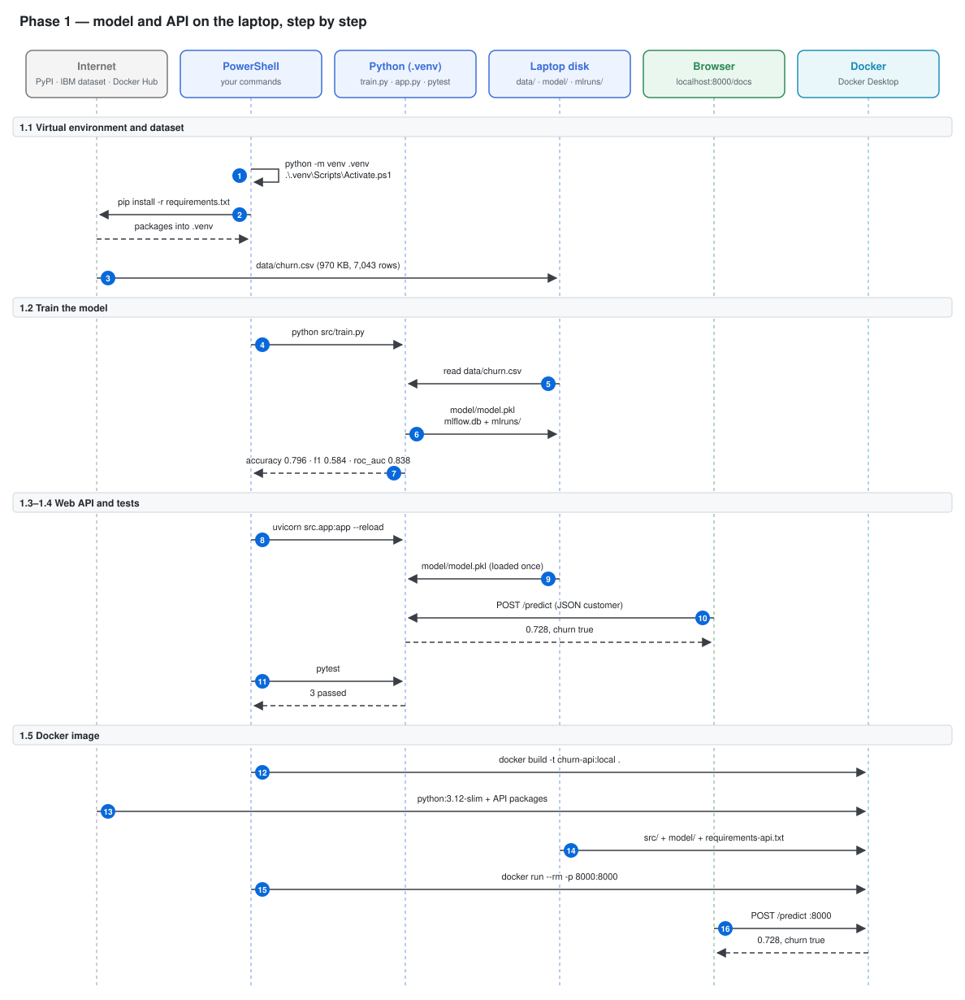
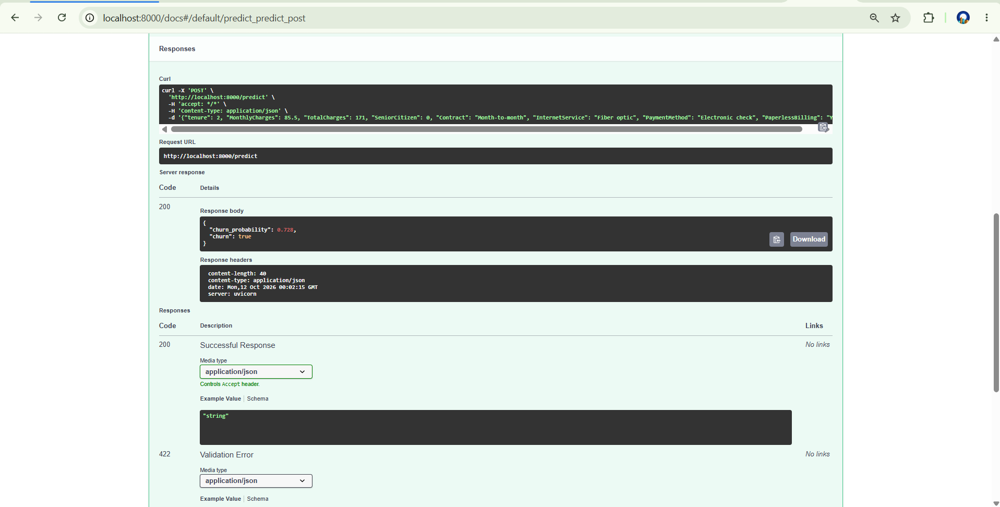

# Phase 1 — Simple model + API on the laptop

Goal: train a small churn model, serve it with a web API, test it, and package it in a Docker image. Everything runs on the laptop, so it costs nothing. The same files go to Azure later.

---

## Architecture of this phase



Read it from top to bottom. Each box at the top is a tool or a service; the dashed line under it is its timeline. Each blue number is one arrow = one call over the network (or inside the laptop). Solid arrow = a request; dashed arrow = the answer that comes back. The table below has one row per number: what you type, which tool is called, what is sent and what comes back.

| # | Command (you type) | Tool called | Sends | Gets back |
|---|---|---|---|---|
| | **1.1  Virtual environment and dataset** | | | |
| 1 | `python -m venv .venv` | Python | — | .venv folder; prompt shows (.venv) |
| 2 | `pip install -r requirements.txt` | pip → PyPI (HTTPS) | requirements.txt (package list) | pandas, scikit-learn, MLflow, FastAPI, pytest… in .venv |
| 3 | `Invoke-WebRequest -Uri <IBM CSV> -OutFile data/churn.csv` | PowerShell → raw.githubusercontent.com | the URL | data/churn.csv on disk |
| | **1.2  Train the model** | | | |
| 4 | `python src/train.py` | Python | — | starts training |
| 5 | ↳ same command | pandas | data/churn.csv | a table of 7,043 customers |
| 6 | ↳ same command | joblib + MLflow | trained pipeline + metrics | model/model.pkl, local MLflow run |
| 7 | ↳ same command | print | — | metrics on screen |
| | **1.3–1.4  Web API and tests** | | | |
| 8 | `uvicorn src.app:app --reload` | uvicorn (web server) | — | API on http://localhost:8000 |
| 9 | ↳ same command | joblib | model/model.pkl | model in memory |
| 10 | — (click Try it out in /docs) | browser → FastAPI | 8 customer fields as JSON | churn_probability 0.728, churn true |
| 11 | `pytest` | pytest + FastAPI TestClient | tests/test_app.py | 3 passed |
| | **1.5  Docker image** | | | |
| 12 | `docker build -t churn-api:local .` | Docker | Dockerfile + build context | image churn-api:local |
| 13 | ↳ same command | Docker Hub + PyPI | image and package names | base image + pinned packages (requirements-api.txt) |
| 14 | ↳ same command | Docker build context | files not in .dockerignore | copied into the image |
| 15 | `docker run --rm -p 8000:8000 churn-api:local` | Docker | port mapping 8000 → 8000 | container running the API |
| 16 | — (in /docs) | browser → container | customer JSON | 0.728, churn true (same as uvicorn) |

---

## 1.1 Virtual environment and dataset

A **virtual environment** (`.venv`) is a private folder of Python packages for this project only, so it does not mix with other projects.

```powershell
python -m venv .venv
```

Turn it on (the prompt then starts with `(.venv)`):

```powershell
.\.venv\Scripts\Activate.ps1
```

```powershell
python -m pip install --upgrade pip
```

Install the packages from [requirements.txt](../../requirements.txt) (pandas, scikit-learn, MLflow, FastAPI, pytest...):

```powershell
pip install -r requirements.txt
```

Download the IBM Telco Customer Churn dataset:

```powershell
New-Item -ItemType Directory -Force data
```

```powershell
Invoke-WebRequest -Uri "https://raw.githubusercontent.com/IBM/telco-customer-churn-on-icp4d/master/data/Telco-Customer-Churn.csv" -OutFile data/churn.csv
```

Count the rows:

```powershell
(Import-Csv data/churn.csv).Count
```

```
7043
```

Meaning: 7,043 customers, 21 columns. 1,869 of them left (26.5%).

---

## 1.2 Train the model

[src/train.py](../../src/train.py) does this:

1. reads the CSV and keeps 8 columns (4 numbers, 4 text)
2. fills the 11 empty `TotalCharges` values with 0 (new customers with tenure 0)
3. keeps 20% of customers aside for testing
4. scales the numbers, one-hot encodes the text, trains a logistic regression
5. prints and logs the metrics with MLflow, and saves `model/model.pkl`

```powershell
python src/train.py
```

```
accuracy: 0.796
f1:       0.584
roc_auc:  0.838
model saved to model/model.pkl
```

What the numbers mean:

- **accuracy 0.796** — 79.6% of test customers are classified right. Always saying "no churn" already gives 73.5%, so accuracy alone is not enough.
- **F1 0.584** — balance between finding churners and not raising false alarms, for the churn class.
- **ROC-AUC 0.838** — if you take one churner and one non-churner at random, the model gives the churner the higher score 83.8% of the time.

Optional: see the run in the MLflow web page (http://127.0.0.1:5000, stop with Ctrl+C):

```powershell
mlflow ui --backend-store-uri sqlite:///mlflow.db
```

Meaning: MLflow 3 stores local runs in `mlflow.db` and the files in `mlruns/`. Both are git-ignored. The same code logs to Azure ML in Phase 4.

Full results: [docs/results/model_metrics.md](../results/model_metrics.md).

---

## 1.3 Web API

[src/app.py](../../src/app.py) is a FastAPI app:

- `GET /health` → `{"status": "ok"}`
- `POST /predict` → takes one customer, returns the churn probability

It loads `model/model.pkl` once, when it starts.

```powershell
uvicorn src.app:app --reload
```

Open http://localhost:8000/docs → POST /predict → Try it out → paste:

```json
{"tenure": 2, "MonthlyCharges": 85.5, "TotalCharges": 171, "SeniorCitizen": 0, "Contract": "Month-to-month", "InternetService": "Fiber optic", "PaymentMethod": "Electronic check", "PaperlessBilling": "Yes"}
```

```json
{"churn_probability": 0.728, "churn": true}
```

Meaning: a new, month-to-month fiber customer has a 72.8% chance to leave. Above 0.5 → `churn: true`.

---

## 1.4 Tests

[tests/test_app.py](../../tests/test_app.py) has 3 tests: health check, valid prediction between 0 and 1, missing field → error 422. [pytest.ini](../../pytest.ini) lets the tests import `src.app`.

```powershell
pytest
```

```
3 passed
```

Note: the tests need `model/model.pkl`, so train first. CI does the same in Phase 5.

---

## 1.5 Docker image

[Dockerfile](../../Dockerfile): starts from `python:3.12-slim`, installs only [requirements-api.txt](../../requirements-api.txt) (pinned versions, so the pickled model loads with the same scikit-learn), copies `src/` and `model/`, runs as a normal user (not root), listens on port 8000. [.dockerignore](../../.dockerignore) keeps `.venv`, data and docs out of the image.

```powershell
docker build -t churn-api:local .
```

Run it (`--rm` deletes the container when stopped; `-p 8000:8000` connects laptop port 8000 to container port 8000):

```powershell
docker run --rm -p 8000:8000 churn-api:local
```

Open http://localhost:8000/docs and run the same prediction → `0.728`, `churn: true`. Same as uvicorn: the image works.



### Not an error: 404 on the home page

```
INFO:     172.17.0.1:57554 - "GET / HTTP/1.1" 404 Not Found
INFO:     172.17.0.1:57554 - "GET /favicon.ico HTTP/1.1" 404 Not Found
```

Meaning: the API has no home page, only `/health`, `/predict` and `/docs`. Open `/docs`.

---

## 1.6 Commit Phase 1

```powershell
git add .
```

```powershell
git commit -m "Phase 1: model, API, tests and Docker image on the laptop"
```

```powershell
git push
```

---

## Cost at the end of Phase 1

€175.99 left, €0 spent: everything ran on the laptop.
