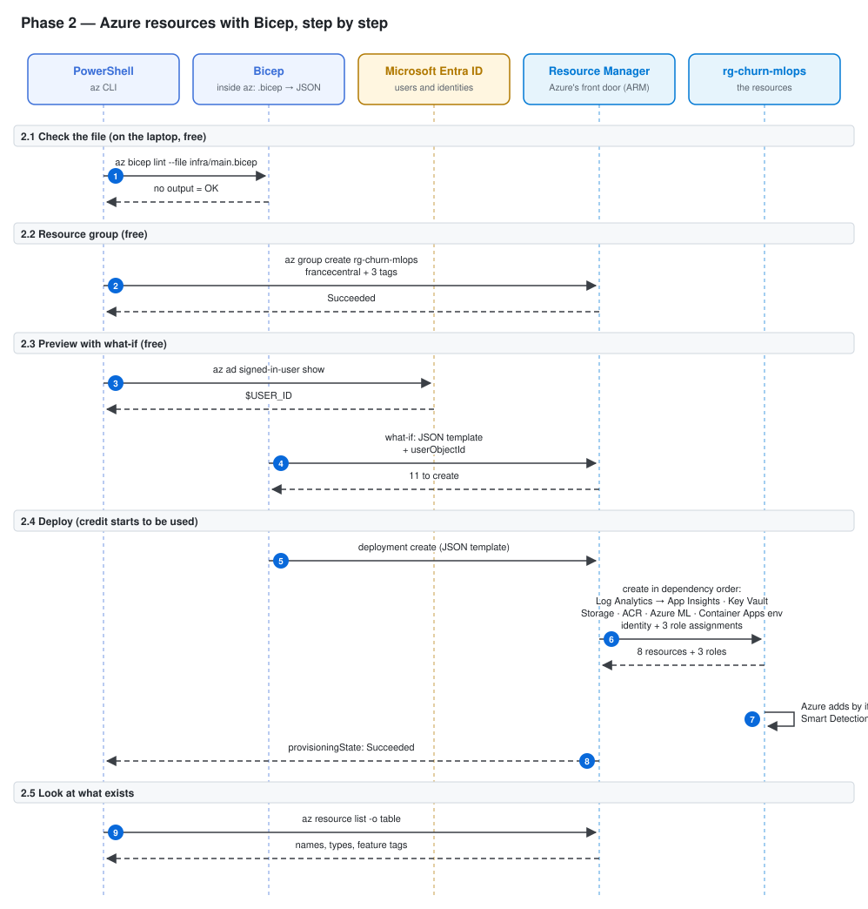
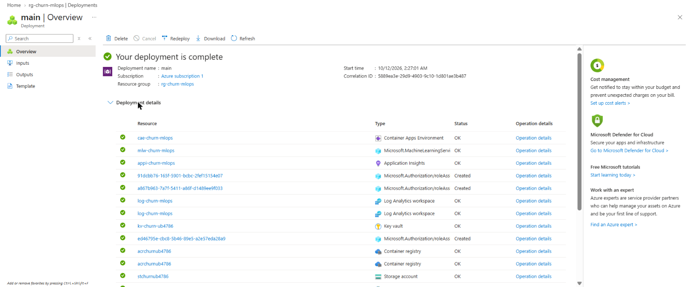
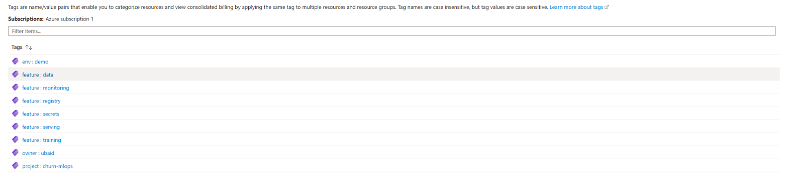

# Phase 2 — Azure resources with Bicep

Goal: create every Azure resource of the project from one file, [infra/main.bicep](../../infra/main.bicep), with one command.

Bicep is "infrastructure as code": instead of clicking in the portal, you describe the resources in a file. Azure reads the file and creates (or updates) exactly what it describes. Running it again does not create duplicates.

---

## Architecture of this phase



Read it from top to bottom. Each box at the top is a tool or a service; the dashed line under it is its timeline. Each blue number is one arrow = one call over the network (or inside the laptop). Solid arrow = a request; dashed arrow = the answer that comes back. The table below has one row per number: what you type, which tool is called, what is sent and what comes back.

| # | Command (you type) | Tool called | Sends | Gets back |
|---|---|---|---|---|
| | **2.1  Check the file (on the laptop, free)** | | | |
| 1 | `az bicep lint --file infra/main.bicep` | Bicep linter | infra/main.bicep | nothing = no errors |
| | **2.2  Resource group (free)** | | | |
| 2 | `az group create --name $RG --location $LOCATION --tags $TAGS` | az CLI → Resource Manager (HTTPS) | name, region, tags | provisioningState Succeeded |
| | **2.3  Preview with what-if (free)** | | | |
| 3 | `$USER_ID = az ad signed-in-user show --query id -o tsv` | az CLI → Microsoft Graph | — | your object id (not a secret) |
| 4 | `az deployment group what-if --resource-group $RG --template-file infra/main.bicep --parameters userObjectId=$USER_ID` | Bicep → Resource Manager | compiled template + parameter | Resource changes: 11 to create |
| | **2.4  Deploy (credit starts to be used)** | | | |
| 5 | `az deployment group create --resource-group $RG --template-file infra/main.bicep --parameters userObjectId=$USER_ID` | Bicep → Resource Manager | compiled template + parameter | deployment main Succeeded |
| 6 | ↳ same command | Resource Manager → each resource provider | each resource's settings + tags | 8 resources + 3 role assignments |
| 7 | — (automatic) | Application Insights | — | 1 extra free item + 1 failed alert deployment (harmless) |
| 8 | ↳ same command | Resource Manager | — | long JSON ending in Succeeded |
| | **2.5  Look at what exists** | | | |
| 9 | `az resource list --resource-group $RG --query "[].{name:name, type:type, feature:tags.feature}" -o table` | az CLI → Resource Manager | a query | names, types and feature tags |

---

## 2.1 Write the Bicep file and check it

The file describes 8 resources and 3 role assignments. Every resource gets 4 tags: `project`, `owner`, `env` and one `feature` tag. The `feature` tag lets Cost Management show the cost per feature later.

| feature | Resource | Name |
|---|---|---|
| monitoring | Log Analytics workspace | log-churn-mlops |
| monitoring | Application Insights | appi-churn-mlops |
| secrets | Key Vault (RBAC mode) | kv-churn-ub4786 |
| secrets | User-assigned managed identity | id-churn-api |
| data | Storage account | stchurnub4786 |
| registry | Container Registry (Basic) | acrchurnub4786 |
| training | Azure ML workspace | mlw-churn-mlops |
| serving | Container Apps environment | cae-churn-mlops |

Check the file for errors (runs on the laptop, free):

```powershell
az bicep lint --file infra/main.bicep
```

Output: nothing. No output means no errors and no warnings.

---

## 2.2 Create the resource group

A resource group is a folder for resources. It is free. Deleting it deletes everything inside (that is how Phase 8 cleans up).

```powershell
. .\scripts\names.ps1
```

```
Names loaded for rg-churn-mlops in francecentral
```

```powershell
az group create --name $RG --location $LOCATION --tags $TAGS
```

Output (shortened):

```json
{
  "location": "francecentral",
  "name": "rg-churn-mlops",
  "properties": { "provisioningState": "Succeeded" },
  "tags": { "env": "demo", "owner": "ubaid", "project": "churn-mlops" }
}
```

Meaning: the group exists in France Central with the 3 base tags. It has no `feature` tag because it is not a feature, only a folder.

---

## 2.3 Preview with what-if (free)

What-if compares the file with what exists in Azure and lists the changes, without doing them.

First, save your own Entra ID user id. Bicep needs it to give you the right to write secrets into Key Vault. It is an id, not a password.

```powershell
$USER_ID = az ad signed-in-user show --query id -o tsv
```

Output: nothing (the id is stored in the variable). `$USER_ID` prints it.

```powershell
az deployment group what-if --resource-group $RG --template-file infra/main.bicep --parameters userObjectId=$USER_ID
```

Output (last resource and summary):

```
+ Microsoft.Storage/storageAccounts/stchurnub4786 [2023-05-01]
      kind:                                "StorageV2"
      location:                            "francecentral"
      properties.allowBlobPublicAccess:    false
      properties.minimumTlsVersion:        "TLS1_2"
      properties.supportsHttpsTrafficOnly: true
      sku.name:                            "Standard_LRS"
      tags.feature:                        "data"
      ...
Resource changes: 11 to create.
```

Meaning: `+` = will be created. 11 = 8 resources + 3 role assignments. Nothing is modified or deleted.

---

## 2.4 Deploy

This is the first step that uses credit. The main cost is the Container Registry Basic plan (about €0.16 a day). The rest is free or a few cents while idle.

```powershell
az deployment group create --resource-group $RG --template-file infra/main.bicep --parameters userObjectId=$USER_ID
```

Output: a long JSON ending with `"provisioningState": "Succeeded"`. It took about 1 minute.

Screenshot (Portal → Resource groups → rg-churn-mlops → Settings → Deployments → main):



### Two surprises (not errors in our work)

1. **A failed deployment `Failure-Anomalies-Alert-Rule-Deployment-...`** appears in the Deployments list. Azure starts it by itself after Application Insights is created, to add a "smart detection" alert. It is not from our Bicep and costs nothing. Our deployment `main` succeeded.
2. **A 9th item "Application Insights Smart Detection" (action group)** appears in the resource group. Azure also adds it by itself. It is free and is deleted with the group.

---

## 2.5 Look at the resources

List every resource with its feature tag (read-only, free):

```powershell
az resource list --resource-group $RG --query "[].{name:name, type:type, feature:tags.feature}" -o table
```

What each one does:

- **Log Analytics** — one place that stores logs from all services, searched with the KQL language. Capped at 0.5 GB a day so it stays inside the free 5 GB a month.
- **Application Insights** — tracks the API's requests, response times and errors. Stores its data in Log Analytics.
- **Key Vault** — safe store for secrets, so none are in code or Git. RBAC mode: access is given with Azure roles.
- **Managed identity** — an Azure identity with no password. The Container App uses it to pull the image and read secrets.
- **Storage account** — holds the dataset and the files Azure ML writes. HTTPS only, no public blobs.
- **Container Registry** — a private "Docker Hub" for our API image. No admin user (no password).
- **Azure ML workspace** — home for training jobs, MLflow runs and the model registry. Free; only compute costs money.
- **Container Apps environment** — the shared space where the Container App runs. No cost until an app runs.
- **Role assignments** — the identity gets AcrPull (registry) and Key Vault Secrets User (vault); you get Key Vault Secrets Officer (vault).

Screenshots:




---

## Cost at the end of Phase 2

€0 shown so far: Azure cost data arrives 8–48 hours late. Expected: about €0.16 a day for the registry.
