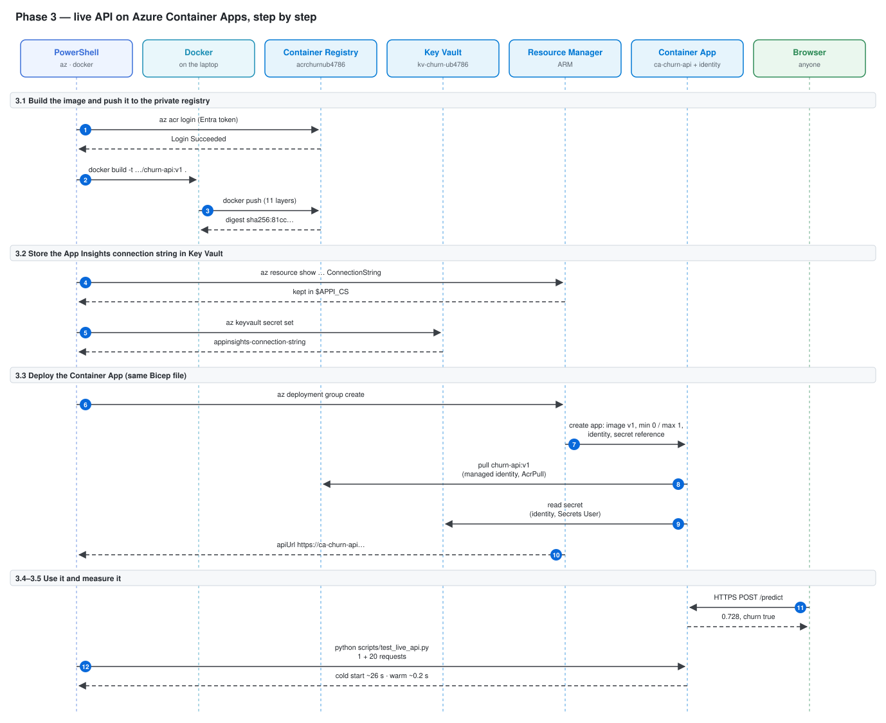
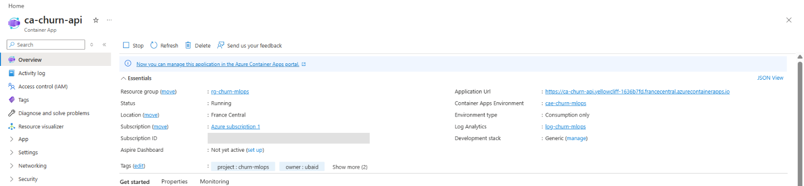
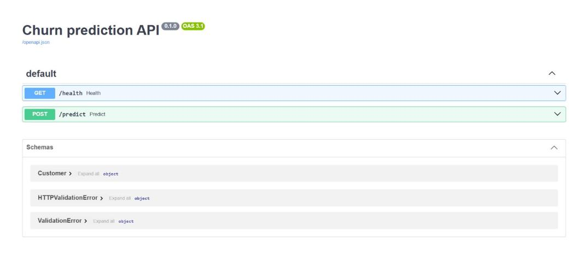

# Phase 3 — Live API on Azure Container Apps

Goal: run the same Docker image from Phase 1 on Azure, with a public HTTPS address, no passwords anywhere, and zero cost when nobody uses it.

---

## Architecture of this phase



Read it from top to bottom. Each box at the top is a tool or a service; the dashed line under it is its timeline. Each blue number is one arrow = one call over the network (or inside the laptop). Solid arrow = a request; dashed arrow = the answer that comes back. The table below has one row per number: what you type, which tool is called, what is sent and what comes back.

| # | Command (you type) | Tool called | Sends | Gets back |
|---|---|---|---|---|
| | **3.1  Build the image and push it to the private registry** | | | |
| 1 | `az acr login --name $ACR` | az CLI → ACR | your Azure login token (no password) | Docker is logged in to the registry |
| 2 | `docker build -t "${IMAGE}:v1" .` | Docker | Dockerfile + src/ + model/ | image acrchurnub4786.azurecr.io/churn-api:v1 |
| 3 | `docker push "${IMAGE}:v1"` | Docker → ACR (HTTPS) | image layers | digest sha256:81cc… |
| | **3.2  Store the App Insights connection string in Key Vault** | | | |
| 4 | `$APPI_CS = az resource show … --query properties.ConnectionString -o tsv` | az CLI → Resource Manager | resource name | the connection string, kept in $APPI_CS (not printed) |
| 5 | `az keyvault secret set --vault-name $KV --name appinsights-connection-string --value $APPI_CS --query name -o tsv` | az CLI → Key Vault (allowed by Secrets Officer role) | secret name + value | only the name is printed |
| | **3.3  Deploy the Container App (same Bicep file)** | | | |
| 6 | `az deployment group create … --query properties.outputs.apiUrl.value -o tsv` | Bicep → Resource Manager | template with the new Container App | only new things are created |
| 7 | ↳ same command | Resource Manager → Container Apps | app settings | app ca-churn-api |
| 8 | — (automatic) | Container Apps → ACR | identity token | the image |
| 9 | — (automatic) | Container Apps → Key Vault | identity token | env variable APPLICATIONINSIGHTS_CONNECTION_STRING |
| 10 | ↳ same command | Resource Manager | — | the public address |
| | **3.4–3.5  Use it and measure it** | | | |
| 11 | — (in /docs) | browser → Container App ingress → port 8000 | customer JSON | 0.728, churn true |
| 12 | `python scripts/test_live_api.py` | Python urllib → HTTPS | 21 POST /predict | cold start ~26 s, warm ~0.2 s → docs/results/api_speed.md |

---

## 3.1 Build the image and push it to the registry

The image is built on the laptop. `az acr build` (build in the cloud) is not used because free-trial subscriptions often block ACR Tasks.

The image name is in [scripts/names.ps1](../../scripts/names.ps1): `$IMAGE = acrchurnub4786.azurecr.io/churn-api`. The first part of the name is the registry address, so `docker push` sends the image to our private registry, not to Docker Hub. Docker Hub is only used to download the public base image `python:3.12-slim`.

```powershell
. .\scripts\names.ps1
```

```
Names loaded for rg-churn-mlops in francecentral
```

Log Docker in to the registry with your Azure login (no password, no admin user):

```powershell
az acr login --name $ACR
```

```
Login Succeeded
```

Build the image with the registry name and tag `v1`:

```powershell
docker build -t "${IMAGE}:v1" .
```

Output (shortened):

```
[+] Building 4.8s (13/13) FINISHED
 => CACHED [2/7] WORKDIR /app
 => CACHED [3/7] COPY requirements-api.txt .
 => CACHED [4/7] RUN pip install --no-cache-dir -r requirements-api.txt
 => CACHED [5/7] COPY src/ src/
 => CACHED [6/7] COPY model/ model/
 => CACHED [7/7] RUN useradd --create-home appuser
 => => naming to acrchurnub4786.azurecr.io/churn-api:v1
```

Meaning: `CACHED` = Docker reused the layers built in Phase 1, so it took only 5 seconds.

### Error: repository not found

```powershell
az acr repository show-tags --name $ACR --repository churn-api -o table
```

```
Error: repository "churn-api" is not found.
```

Cause: the image was built but not pushed yet; it was only on the laptop. Fix: push it.

```powershell
docker push "${IMAGE}:v1"
```

```
The push refers to repository [acrchurnub4786.azurecr.io/churn-api]
6912e23eb445: Pushed
... (11 layers)
v1: digest: sha256:81cc16af0bd8593b79310abcf92686cf4d986f8475ecf8ec2c9379501c193c6a size: 856
```

Meaning: each `Pushed` line is one layer of the image. The digest is the unique fingerprint of this exact image.

---

## 3.2 Store the Application Insights connection string in Key Vault

The API will send its telemetry to Application Insights (Phase 6). The connection string that says "where to send it" is kept in Key Vault, never in code or Git.

Read it into a variable (not printed):

```powershell
$APPI_CS = az resource show --resource-group $RG --name $APPI --resource-type Microsoft.Insights/components --query properties.ConnectionString -o tsv
```

Output: nothing.

Store it as a secret (prints only the name, never the value):

```powershell
az keyvault secret set --vault-name $KV --name appinsights-connection-string --value $APPI_CS --query name -o tsv
```

```
appinsights-connection-string
```

Meaning: it worked because Bicep gave you the Key Vault Secrets Officer role in Phase 2. Without that role, RBAC mode would answer `Forbidden`, even for the subscription owner.

The same secret is also written in [infra/main.bicep](../../infra/main.bicep), so a fresh redeploy creates it in one command.

---

## 3.3 Deploy the Container App

The Container App was added to [infra/main.bicep](../../infra/main.bicep) (the same file as Phase 2):

- external HTTPS ingress → port 8000 in the container
- min 0 and max 1 replicas (scale to zero = no cost when idle)
- image pulled from the registry with the managed identity
- the Key Vault secret given to the app as the variable `APPLICATIONINSIGHTS_CONNECTION_STRING`
- output `apiUrl` = the public address

Check the file:

```powershell
az bicep lint --file infra/main.bicep
```

Output: nothing (no errors).

Deploy and print only the address:

```powershell
az deployment group create --resource-group $RG --template-file infra/main.bicep --parameters userObjectId=$USER_ID --query properties.outputs.apiUrl.value -o tsv
```

```
https://ca-churn-api.yellowcliff-1636b7fd.francecentral.azurecontainerapps.io
```

Meaning: Bicep only added what was new (the Container App and the secret); the 8 resources from Phase 2 stayed as they were. `--query ... -o tsv` picks one value out of the big JSON answer.

Screenshot (Portal → ca-churn-api → Overview): Status Running, Consumption only environment, the Application URL.



---

## 3.4 Test the live API

Open `https://ca-churn-api.yellowcliff-1636b7fd.francecentral.azurecontainerapps.io/docs`:



In `/docs`: POST /predict → Try it out → paste the test customer → Execute.

```json
{"tenure": 2, "MonthlyCharges": 85.5, "TotalCharges": 171, "SeniorCitizen": 0, "Contract": "Month-to-month", "InternetService": "Fiber optic", "PaymentMethod": "Electronic check", "PaperlessBilling": "Yes"}
```

Response (code 200):

```json
{
  "churn_probability": 0.728,
  "churn": true
}
```

Meaning: the live API gives the same 0.728 as the laptop and the local Docker container, so the cloud runs exactly the same model.


---

## 3.5 Measure the live API speed

[scripts/test_live_api.py](../../scripts/test_live_api.py) sends 1 first request (timed as the cold start), then 20 more, and writes the results to [docs/results/api_speed.md](../results/api_speed.md). It uses only Python's built-in modules.

For a real cold start, the API was left unused for about 10 minutes first, so Azure scaled it down to 0 copies.

```powershell
python scripts/test_live_api.py
```

Output (shortened):

```
cold start: 25.91 s, answer: {'churn_probability': 0.728, 'churn': True}
request  1: 4523 ms
request  2: 1717 ms
request  3: 291 ms
request  4: 367 ms
...
request 19: 210 ms
request 20: 269 ms
average: 513 ms, fastest: 118 ms, slowest: 4523 ms
saved docs/results/api_speed.md
```

What it means:

- **Cold start 25.9 s:** with min 0 replicas, no container runs when nobody uses the API, so it costs nothing. The first request has to wait while Azure pulls the image, starts the container and loads the model.
- **Requests 1 and 2 (4.5 s and 1.7 s):** the container was up but still warming up. They push the average up to 513 ms.
- **Requests 3–20 average 223 ms** (the median of all 20 is 238 ms). That is the real speed once the app is awake.
- **Trade-off:** min 0 replicas means €0 when idle but a ~26 s first request. Min 1 replica would remove the cold start but run all the time and use up the free allowance in about 2 days.

---

## Cost at the end of Phase 3

€175.99 left, €0 shown: Azure cost data arrives 8–48 hours late. Expected: the registry (~€0.16 a day). The Container App costs €0 because it scales to 0 and stays inside the free monthly allowance.

## Commit Phase 3

```powershell
git add .
```

```powershell
git commit -m "Phase 3: deploy API to Container Apps"
```

```powershell
git push
```
