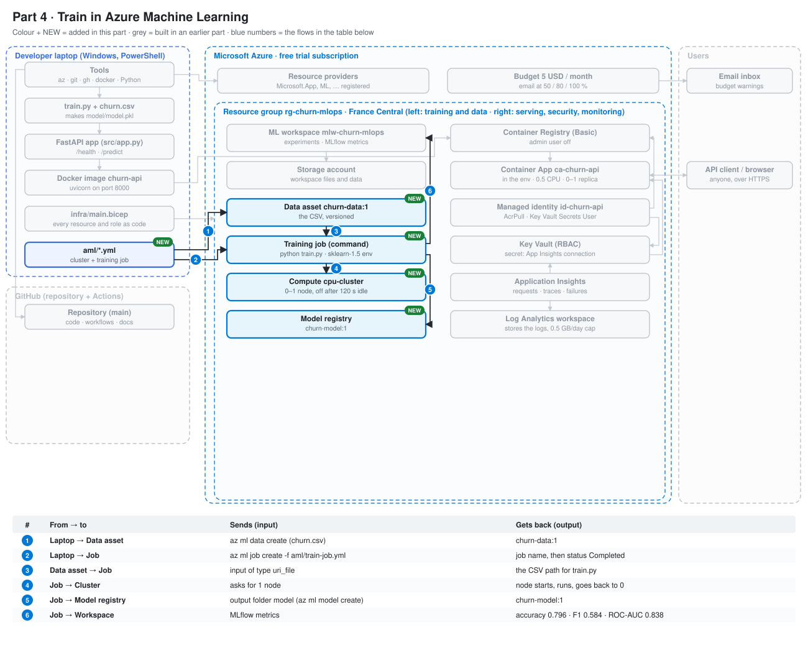
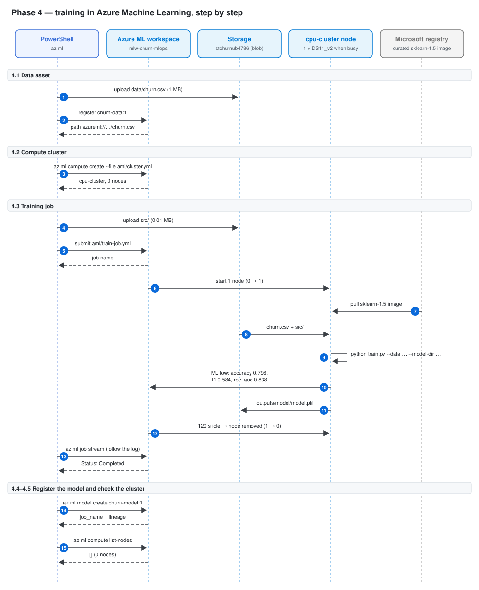
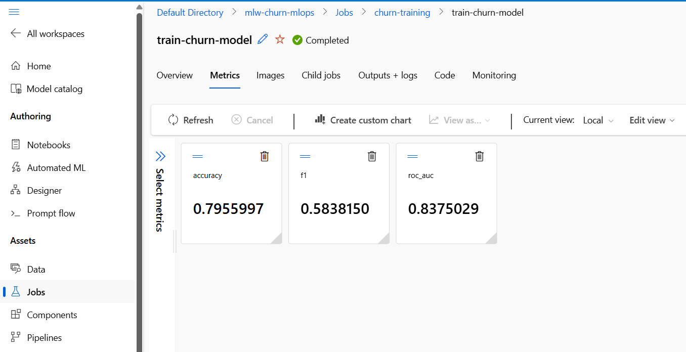
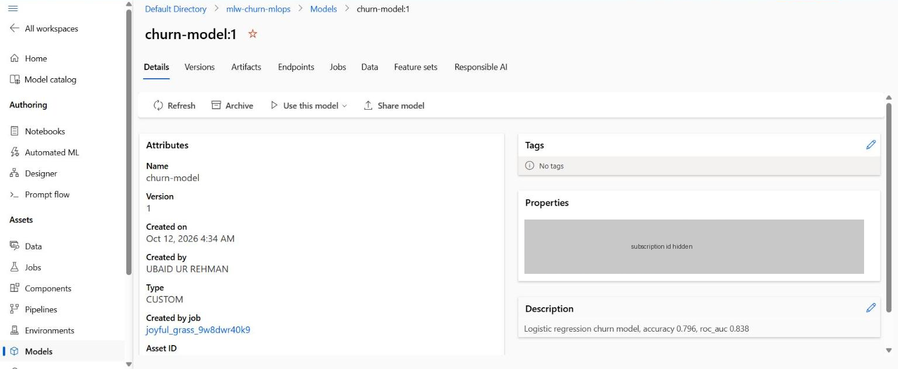
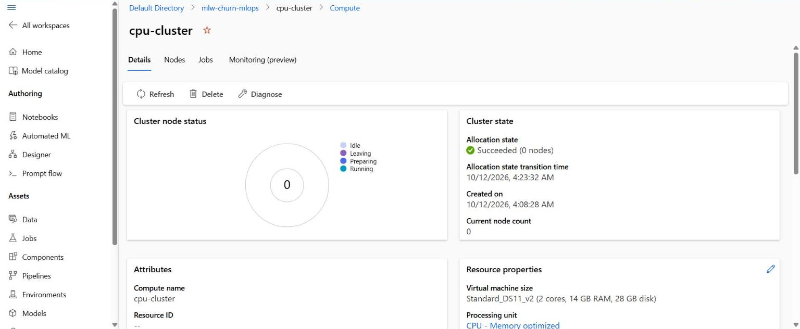

# Phase 4 — Train in Azure Machine Learning

Goal: run the same [src/train.py](../../src/train.py) in the cloud, on a small compute cluster that costs nothing when idle, log the metrics with MLflow in the workspace, and register the model.

---

## Where this phase fits

The system so far. Coloured boxes marked NEW are added in this phase, grey ones come from earlier phases, and the table under the picture says what each numbered arrow sends and gets back.



---

## Architecture of this phase



Read it from top to bottom. Each box at the top is a tool or a service; the dashed line under it is its timeline. Each blue number is one arrow = one call over the network (or inside the laptop). Solid arrow = a request; dashed arrow = the answer that comes back. The table below has one row per number: the command, which tool is called, what is sent and what comes back.

| # | Command | Tool called | Sends | Gets back |
|---|---|---|---|---|
| | **4.1  Data asset** | | | |
| 1 | `az ml data create --name churn-data --version 1 --type uri_file --path data/churn.csv …` | az ml → Storage (workspaceblobstore) | data/churn.csv | file stored under `LocalUpload/<hash>/` |
| 2 | ↳ same command | az ml → workspace | name, version, path | data asset churn-data:1 |
| | **4.2  Compute cluster** | | | |
| 3 | `az ml compute create --file aml/cluster.yml …` | az ml → workspace | aml/cluster.yml | cpu-cluster, min 0 / max 1, 0 nodes now |
| | **4.3  Training job** | | | |
| 4 | `$JOB = az ml job create --file aml/train-job.yml … --query name -o tsv` | az ml → Storage | the src folder only | code snapshot |
| 5 | ↳ same command | az ml → workspace | job definition (code, input, env, compute) | job name, e.g. joyful_grass_9w8dwr40k9 |
| 6 | — (automatic) | workspace → cluster | — | a virtual machine |
| 7 | — (automatic) | node → Microsoft registry | — | Python 3.10 + scikit-learn 1.5.2 |
| 8 | — (automatic) | node ← Storage | — | input data and code on the node |
| 9 | — (automatic) | Python on the node | — | trained model |
| 10 | — (automatic) | MLflow → workspace | params + metrics | visible in Azure ML studio |
| 11 | — (automatic) | node → Storage | model.pkl | job output folder |
| 12 | — (automatic) | workspace → cluster | — | no machine, no cost |
| 13 | `az ml job stream --name $JOB …` | az ml → workspace | job name | live log ending in Status: Completed |
| | **4.4–4.5  Register the model and check the cluster** | | | |
| 14 | `az ml model create --name churn-model --version 1 --type custom_model --path "azureml://jobs/$JOB/outputs/model" …` | az ml → workspace | pointer to the job output | model churn-model:1 with job_name (lineage) |
| 15 | `az ml compute list-nodes --name $AML_CLUSTER …` | az ml → workspace | cluster name | [] = 0 nodes = €0 per hour |

---

## 4.1 Upload the dataset as a data asset

A **data asset** is a named, versioned pointer to a file. Azure ML copies the CSV into the workspace's Blob Storage. Jobs then use `churn-data:1` instead of a path on the laptop. If the data changes, you make version 2 and old jobs still point to version 1.

```powershell
az ml data create --name churn-data --version 1 --type uri_file --path data/churn.csv --description "IBM Telco customer churn, 7043 customers" --resource-group $RG --workspace-name $AML_WORKSPACE
```

Output (shortened, subscription id hidden):

```json
{
  "description": "IBM Telco customer churn, 7043 customers",
  "name": "churn-data",
  "path": "azureml://subscriptions/<id>/resourcegroups/rg-churn-mlops/workspaces/mlw-churn-mlops/datastores/workspaceblobstore/paths/LocalUpload/c9f74bf3.../churn.csv",
  "type": "uri_file",
  "version": "1"
}
```

What it means:

- `type: uri_file` = the asset is one file (`uri_folder` would be a folder).
- `datastores/workspaceblobstore` = the file is in the default blob container of the storage account `stchurnub4786`, which Bicep linked to the workspace in Phase 2.
- `LocalUpload/c9f74bf3...` = Azure ML names the upload folder with a hash of the file, so uploading the same file again does not copy it twice.
- Cost: about 1 MB of storage, under €0.01 a month.

---

## 4.2 Create the compute cluster

A **compute cluster** is a group of virtual machines that Azure ML starts when a job arrives and stops when there is no work. With min 0 nodes, no machine runs (and nothing is paid) while it is idle.

The settings are in [aml/cluster.yml](../../aml/cluster.yml): 1 node of `Standard_DS11_v2` (2 vCPU, 14 GB), min 0, max 1, off after 120 s idle, with the 4 project tags.

```powershell
az ml compute create --file aml/cluster.yml --resource-group $RG --workspace-name $AML_WORKSPACE
```

Output (shortened, subscription id hidden):

```json
{
  "idle_time_before_scale_down": 120,
  "location": "francecentral",
  "max_instances": 1,
  "min_instances": 0,
  "name": "cpu-cluster",
  "provisioning_state": "Succeeded",
  "size": "Standard_DS11_v2",
  "ssh_public_access_enabled": true,
  "tags": { "env": "demo", "feature": "training", "owner": "ubaid", "project": "churn-mlops" },
  "tier": "dedicated",
  "type": "amlcompute"
}
```

What it means:

- `Succeeded` with `min_instances: 0` = the cluster exists but has no machine yet. It costs €0 until a job runs.
- `dedicated` = a normal machine that is never taken away (the cheaper "low priority" tier can be stopped by Azure in the middle of a job, and free trials often have no quota for it).
- `ssh_public_access_enabled: true` looks risky but is harmless: no SSH user or key was given, so nobody can log in.
- The vCPU quota of the free trial (about 4 per region) was enough for 2 vCPU.
- Cost: about €0.20 per hour, only while a node runs.

---

## 4.3 Run train.py in the cloud (command job)

A **command job** = "run this command, with this code, in this environment, on this compute". The file is [aml/train-job.yml](../../aml/train-job.yml):

- `code: ../src` uploads only the `src` folder (0.01 MB), not `.venv`, the data or the docs.
- `command` runs the same [src/train.py](../../src/train.py) as on the laptop. `${{inputs.data}}` and `${{outputs.model}}` are replaced by Azure ML with real paths on the node.
- `environment` is Microsoft's ready-made `sklearn-1.5` image (Python, scikit-learn, pandas, MLflow), so no Docker image is built.
- MLflow needs no change: inside a job, Azure ML points MLflow at the workspace by itself.

Submit the job and keep its name:

```powershell
$JOB = az ml job create --file aml/train-job.yml --resource-group $RG --workspace-name $AML_WORKSPACE --query name -o tsv
```

Output (shortened):

```
az : Class AutoDeleteSettingSchema: This is an experimental class, and may change at any time. ...
    + FullyQualifiedErrorId : NativeCommandError
Class IntellectualPropertySchema: This is an experimental class, ...
Uploading src (0.01 MBs): 100%|##########| 5796/5796
```

### Not an error: the red "experimental class" lines

They are warnings from the `ml` extension, written to stderr. Windows PowerShell 5.1 shows anything on stderr in red as `NativeCommandError`, even when the command worked. The real result is the upload line and the job name in `$JOB`.

Follow the log live:

```powershell
az ml job stream --name $JOB --resource-group $RG --workspace-name $AML_WORKSPACE
```

```
RunId: joyful_grass_9w8dwr40k9
Web View: https://ml.azure.com/runs/joyful_grass_9w8dwr40k9?wsid=/subscriptions/<id>/resourcegroups/rg-churn-mlops/workspaces/mlw-churn-mlops
```

Meaning: `RunId` is the job name. The Web View link opens the same job in Azure ML studio. The log then waits a few minutes while the node starts and downloads the environment.

End of the log: `accuracy: 0.796`, then `Execution Summary` with `Status: Completed`.

What Azure ML studio shows for the job (Jobs → churn-training → train-churn-model → Overview):

| Field | Value |
|---|---|
| Status | Completed |
| Duration | 3 min 6 s (node start + environment download + training) |
| Environment | `sklearn-1.5`, version 55 (curated, from the `azureml` registry) |
| Compute | cpu-cluster, 1 instance |
| Input | data asset `churn-data:1` |
| Output | `model` folder (holds `model.pkl`) |
| Params (MLflow) | features 8, model LogisticRegression |
| Metrics (MLflow) | accuracy 0.7956, f1 0.5838, roc_auc 0.8375 |
| Git commit | `3c65e0c` (Azure ML records the commit the code came from) |

What it means:

- **Same metrics as the laptop** (0.796 / 0.584 / 0.838): same code, same data, same random split (`random_state=42`) → same model. The cloud run is reproducible.
- The metrics appear in the studio without any Azure code in `train.py`: MLflow's `log_metric` sends them to the workspace inside a job.
- Azure ML saved the Git commit, so you can always find which code produced this run.
- Cost: about 3 minutes of one DS11_v2 node, about €0.01.

Screenshots:




---

## 4.4 Register the model

The **model registry** is a list of named, versioned models in the workspace. Registering gives the job's output folder a stable name (`churn-model:1`) that the deploy pipeline (Phase 5) can download, and it keeps the link to the job that made it.

If the terminal is new, set the job name again:

```powershell
$JOB = "joyful_grass_9w8dwr40k9"
```

```powershell
az ml model create --name churn-model --version 1 --type custom_model --path "azureml://jobs/$JOB/outputs/model" --description "Logistic regression churn model, accuracy 0.796, roc_auc 0.838" --resource-group $RG --workspace-name $AML_WORKSPACE
```

Output (shortened, subscription id hidden):

```json
{
  "description": "Logistic regression churn model, accuracy 0.796, roc_auc 0.838",
  "job_name": "joyful_grass_9w8dwr40k9",
  "name": "churn-model",
  "path": "azureml://subscriptions/<id>/resourceGroups/rg-churn-mlops/workspaces/mlw-churn-mlops/datastores/workspaceblobstore/paths/azureml/joyful_grass_9w8dwr40k9/model/",
  "stage": "Development",
  "type": "custom_model",
  "version": "1"
}
```

What it means:

- `azureml://jobs/$JOB/outputs/model` is a short way to say "the `model` output of that job". Azure ML turned it into the real blob path, which contains the job name.
- `job_name` = **lineage**: from the model you can go back to the job, its code (Git commit), its data (`churn-data:1`) and its metrics.
- `custom_model` = a plain folder with our `model.pkl` (not the MLflow model format).
- `stage: Development` is only a label; it changes nothing.
- No file was copied and no compute ran: cost €0.



---

## 4.5 Check the cluster is back to 0 nodes

A node left running is the biggest cost risk of the project (about €5 a day). Check that the cluster turned itself off (read-only, free):

```powershell
az ml compute list-nodes --name $AML_CLUSTER --resource-group $RG --workspace-name $AML_WORKSPACE
```

```
[]
```

Meaning: an empty list = no machine is running = €0 per hour.

Azure ML studio → Compute → Compute clusters → cpu-cluster shows the same: **Current node count 0**, Allocation state "Succeeded (0 nodes)" since 4:23 AM. The job ended at about 4:18 AM, so the node waited the 120 s idle time, then was removed.



---

## 4.6 Fallback (not needed)

The plan had a fallback if the free trial had no vCPU quota for the cluster: train on the laptop and send the MLflow run to the workspace. The cluster worked on the first try, so it was not used.

---

## Cost at the end of Phase 4

One job of about 3 minutes on one DS11_v2 node (about €0.01), 1 MB in Blob Storage, and €0 while the cluster is at 0 nodes. Azure cost data arrives 8–48 hours late.

## Commit Phase 4

```powershell
git add .
```

```powershell
git commit -m "Phase 4: train and register the model in Azure ML"
```

```powershell
git push
```
