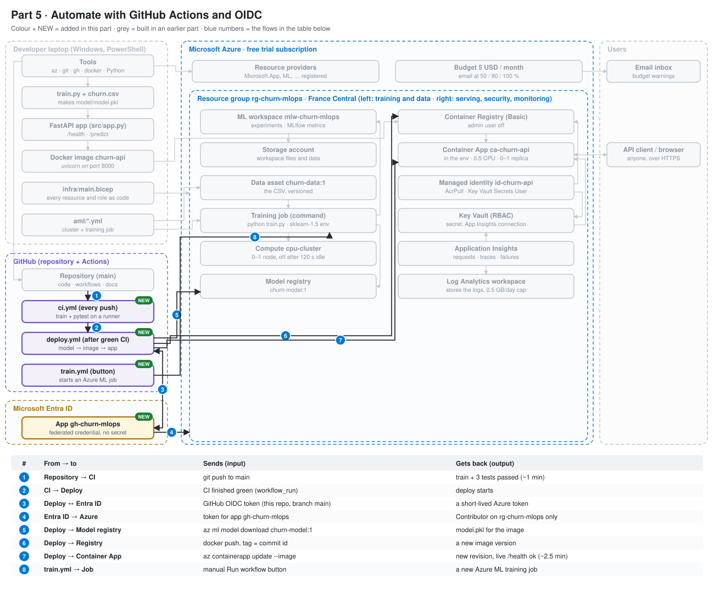
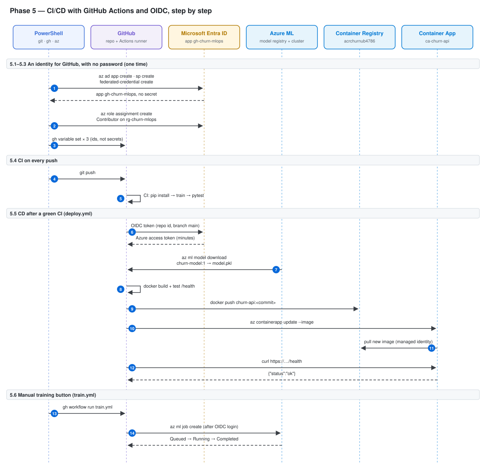
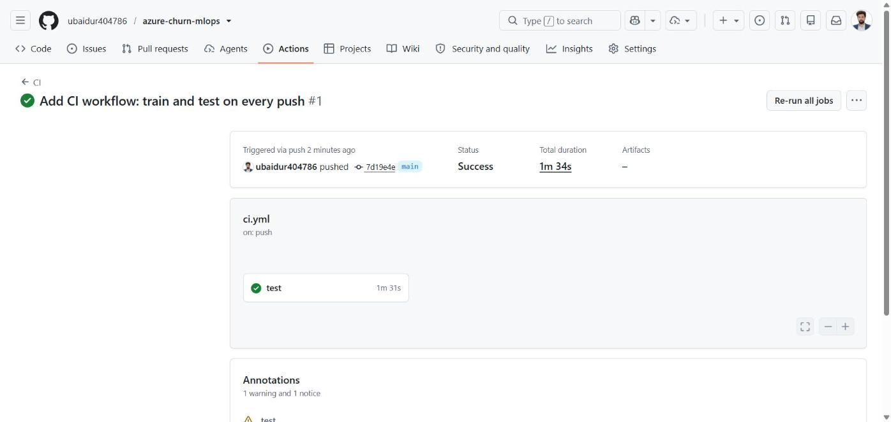
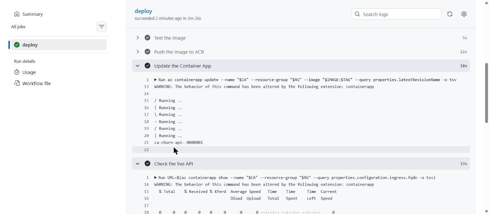
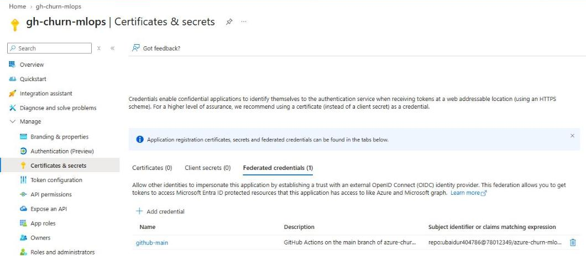

# Phase 5 — CI/CD with GitHub Actions + OIDC

Goal: every push is tested automatically (CI), and every push to `main` is deployed to Azure automatically (CD). GitHub logs in to Azure with **OIDC**: no password or secret is stored in GitHub.

---

## Where this phase fits

The system so far. Coloured boxes marked NEW are added in this phase, grey ones come from earlier phases, and the table under the picture says what each numbered arrow sends and gets back.



---

## Architecture of this phase



Read it from top to bottom. Each box at the top is a tool or a service; the dashed line under it is its timeline. Each blue number is one arrow = one call over the network (or inside the laptop). Solid arrow = a request; dashed arrow = the answer that comes back. The table below has one row per number: the command, which tool is called, what is sent and what comes back.

| # | Command | Tool called | Sends | Gets back |
|---|---|---|---|---|
| | **5.1–5.3  An identity for GitHub, with no password (one time)** | | | |
| 1 | `az ad app create / az ad sp create / az ad app federated-credential create …` | az CLI → Microsoft Graph | app name + infra/github-federated-credential.json | app with 0 secrets, 1 trust rule |
| 2 | `az role assignment create --assignee-object-id $SP_ID --role Contributor --scope $RG_ID …` | az CLI → Azure RBAC | identity + role + scope | role on the resource group only |
| 3 | `gh variable set AZURE_CLIENT_ID --body $APP_ID --repo $GH_REPO` | gh → GitHub | client, tenant and subscription ids | 3 repository variables |
| | **5.4  CI on every push** | | | |
| 4 | `git push` | git → GitHub (HTTPS) | new commits | CI starts |
| 5 | — (automatic, ci.yml) | GitHub runner (Ubuntu) | the repo files | green ✓ in about 1 min |
| | **5.5  CD after a green CI (deploy.yml)** | | | |
| 6 | — (automatic, azure/login) | GitHub → Entra ID | signed token: repo:ubaidur404786@…/azure-churn-mlops@…:ref:refs/heads/main | Azure access token valid for minutes |
| 7 | — (automatic) | runner ← Azure ML registry | model name + version | model/model.pkl on the runner |
| 8 | — (automatic) | Docker on the runner | Dockerfile + model.pkl | image tagged with the commit id, health ok |
| 9 | — (automatic) | runner → ACR | image layers | image in the registry |
| 10 | — (automatic) | runner → Container Apps | new image tag | new revision ca-churn-api--0000001 |
| 11 | — (automatic) | Container Apps → ACR | identity token | new image |
| 12 | — (automatic) | runner → live API | GET /health | {"status":"ok"} |
| | **5.6  Manual training button (train.yml)** | | | |
| 13 | `gh workflow run train.yml --repo $GH_REPO` | gh → GitHub | workflow name | a new run |
| 14 | — (automatic) | runner → Azure ML | aml/train-job.yml + src/ | job on cpu-cluster; status checked every 30 s |

---

## 5.1 App registration, service principal and federated credential

Three objects in Entra ID (all free):

- **App registration** `gh-churn-mlops` — the identity's "name card".
- **Service principal** — the copy of the app inside your tenant that can receive Azure roles.
- **Federated credential** — the trust rule in [infra/github-federated-credential.json](../../infra/github-federated-credential.json): trust tokens from `token.actions.githubusercontent.com` only when the subject is `repo:ubaidur404786/azure-churn-mlops:ref:refs/heads/main`. A run from another repo or another branch is refused.

The app name is in [scripts/names.ps1](../../scripts/names.ps1) as `$GH_APP`.

```powershell
$APP_ID = az ad app create --display-name $GH_APP --query appId -o tsv
```

Output: nothing (`$APP_ID` holds the app's client id, a public id, not a secret).

```powershell
az ad sp create --id $APP_ID --query "{appId:appId, displayName:displayName, id:id}" -o table
```

```
AppId                                 DisplayName
------------------------------------  --------------
f2d95e42-4fd4-429f-aa24-a99199430d2a  gh-churn-mlops
```

```powershell
az ad app federated-credential create --id $APP_ID --parameters infra/github-federated-credential.json --query "{name:name, subject:subject}" -o table
```

```
Name         Subject
-----------  --------------------------------------------------------
github-main  repo:ubaidur404786/azure-churn-mlops:ref:refs/heads/main
```

What it means:

- `AppId` is the **client id** GitHub will use in step 5.3 (`AZURE_CLIENT_ID`). It is an id, safe to show.
- The subject must match exactly: if the repo is renamed or the workflow runs on another branch, the login fails with `AADSTS70021: No matching federated identity record found`.
- The app has no password and no certificate. That is the point of OIDC: nothing can leak.

---

## 5.2 Role: Contributor on the resource group only

The identity can log in but has no rights yet. **Contributor** on `rg-churn-mlops` lets the deploy workflow download the model from Azure ML, push images to ACR and update the Container App. It gives nothing outside this group, no billing, and no right to give roles to others (that needs Owner or User Access Administrator): **least privilege**.

Roles are given to the service principal's **object id**, not to the app id:

```powershell
$SP_ID = az ad sp show --id $APP_ID --query id -o tsv
```

The **scope** is the full id of the resource group:

```powershell
$RG_ID = az group show --name $RG --query id -o tsv
```

```powershell
az role assignment create --assignee-object-id $SP_ID --assignee-principal-type ServicePrincipal --role Contributor --scope $RG_ID --query "{principalType:principalType, scope:scope}" -o table
```

```
PrincipalType     Scope
----------------  ---------------------------------------------------
ServicePrincipal  /subscriptions/<id>/resourceGroups/rg-churn-mlops
```

What it means:

- `--assignee-principal-type ServicePrincipal` tells Azure what kind of identity it is, so the assignment works even if Entra ID has not finished copying the new identity everywhere (a common "principal not found" error just after creating it).
- Scope = resource group: in Phase 8, deleting the group also deletes this assignment.

---

## 5.3 GitHub repository variables

The workflows need 3 ids to log in. They are **ids, not secrets** (useless without the federated trust rule), so they are stored as repository *variables*. Workflows read them as `${{ vars.AZURE_CLIENT_ID }}`.

```powershell
gh variable set AZURE_CLIENT_ID --body $APP_ID --repo $GH_REPO
```

```powershell
gh variable set AZURE_TENANT_ID --body (az account show --query tenantId -o tsv) --repo $GH_REPO
```

```powershell
gh variable set AZURE_SUBSCRIPTION_ID --body (az account show --query id -o tsv) --repo $GH_REPO
```

`(az ... -o tsv)` runs the az command first and passes its answer as the value, so you never copy an id by hand.

```powershell
gh variable list --repo $GH_REPO
```

```
AZURE_CLIENT_ID        f2d95e42-...  less than a minute ago
AZURE_SUBSCRIPTION_ID  <id>          less than a minute ago
AZURE_TENANT_ID        <id>          less than a minute ago
```

Meaning: the 3 variables exist. GitHub → repo → Settings → Secrets and variables → Actions → Variables shows the same list.

---

## 5.4 CI workflow: train and test on every push

[.github/workflows/ci.yml](../../.github/workflows/ci.yml) runs on a free GitHub Linux machine (free without limit for public repos). It repeats Phase 1: install Python 3.12 and [requirements.txt](../../requirements.txt), `python src/train.py`, `pytest`. It does not touch Azure, so it needs no login and only `contents: read` permission.

```powershell
git add .github/workflows/ci.yml
```

```powershell
git commit -m "Add CI workflow: train and test on every push"
```

```powershell
git push
```

Watch the run in the terminal:

```powershell
gh run watch --repo $GH_REPO
```

```
✓ main CI · 38197476280
Triggered via push about 2 minutes ago

JOBS
✓ test in 1m31s (ID 114643276200)
  ✓ Set up job
  ✓ Run actions/checkout@v4
  ✓ Run actions/setup-python@v5
  ✓ Install packages
  ✓ Train the model
  ✓ Run the tests
  ...
ANNOTATIONS
! Node.js 20 is deprecated. The following actions target Node.js 20 but are being forced to run on Node.js 24: actions/checkout@v4, actions/setup-python@v5.
- The ubuntu-latest label will migrate to Ubuntu 26 beginning October 19, 2026.

✓ Run CI (38197476280) completed with 'success'
```

What it means:

- Every step has ✓: the model trains and the 3 tests pass on a clean machine, not only on the laptop.
- **Warning: Node.js 20 is deprecated.** GitHub actions are small programs; `checkout@v4` and `setup-python@v5` were written for Node.js 20. Fix: use the newer versions `actions/checkout@v5` and `actions/setup-python@v6` (done in the file; the next run has no warning).
- **Notice: ubuntu-latest → Ubuntu 26.** Only information. `ubuntu-latest` always points to the newest Ubuntu image.

The run is listed in [docs/results/pipeline_runs.md](../results/pipeline_runs.md).



---

## 5.5 (part 1) Check the cloud model works in the API

The deploy workflow will put `churn-model:1` from the Azure ML registry into the API image. Test that first on the laptop.

```powershell
az ml model download --name churn-model --version 1 --download-path model_cloud --resource-group $RG --workspace-name $AML_WORKSPACE
```

```
Downloading the model azureml/joyful_grass_9w8dwr40k9/model/ at model_cloud\churn-model\model
```

Point the API at the downloaded file (`$env:` sets an environment variable for this terminal only; [src/app.py](../../src/app.py) reads `MODEL_PATH`):

```powershell
$env:MODEL_PATH = (Get-ChildItem model_cloud -Recurse -Filter model.pkl).FullName
```

```powershell
pytest
```

### Error: the cloud model cannot be loaded

```
InconsistentVersionWarning: Trying to unpickle estimator StandardScaler from version 1.5.2 when using version 1.9.1.
...
E   AttributeError: Can't get attribute '_RemainderColsList' on <module 'sklearn.compose._column_transformer' ...>
ERROR tests/test_app.py
```

Cause: a scikit-learn model is saved with **pickle**, which stores the inner classes of the library version that made it. Azure ML trained with scikit-learn **1.5.2** (the curated `sklearn-1.5` environment: Python 3.10, numpy 1.22, pandas 1.5). The laptop and the API image use **1.9.1**, where the class `_RemainderColsList` no longer exists. So the file cannot be opened.

Rule: **training and serving must use the same library versions.**

Options:

| Option | Cost / effort | Chosen |
|---|---|---|
| Custom Azure ML environment with scikit-learn 1.9.1 | Azure ML must build a Docker image: a second registry (~€0.16/day) and ACR Tasks, often blocked on free trials | no |
| Train in CI instead of Azure ML | breaks the "model comes from the registry" design | no |
| **Pin the laptop, CI and API to scikit-learn 1.5.2** | only the two requirements files change | **yes** |

The fix was tested first in a separate virtual environment with `scikit-learn==1.5.2`, `numpy==2.1.3`, `pandas==2.2.3`, `joblib==1.4.2` (Python 3.12, with warnings turned into errors): the cloud model loads with **no warning** and predicts **0.728**, the same as before.

Changed files: [requirements-api.txt](../../requirements-api.txt) and [requirements.txt](../../requirements.txt) now pin these 4 versions, so laptop, CI, Azure ML and the API all use scikit-learn 1.5.2.

After `pip install -r requirements.txt` (downgrade to the pinned versions), the same test with the cloud model:

```powershell
pytest
```

```
3 passed
```

Meaning: the API now opens the model trained in Azure ML. The deploy can use the registry model.

---

## 5.5 (part 2) Deploy workflow

[.github/workflows/deploy.yml](../../.github/workflows/deploy.yml) is the CD part. It starts **after CI succeeds on `main`** (`workflow_run`), or by hand (`workflow_dispatch`). Steps:

1. checkout the exact commit CI tested; its id becomes the image tag
2. `azure/login` with OIDC: `permissions: id-token: write` lets GitHub create the signed token; the 3 repo variables say which app, tenant and subscription
3. add the `ml` and `containerapp` CLI extensions
4. download `churn-model:1` from the Azure ML registry into `model/model.pkl`
5. `docker build` the API image, tagged with the commit id
6. run the image on the runner and call `/health` (a broken image is never pushed)
7. `az acr login` + `docker push` to `acrchurnub4786`
8. `az containerapp update --image ...` → Azure creates a new **revision** and moves traffic to it
9. call the live `/health` to check the new version answers

Why the commit id as tag: every image in the registry points to exactly one commit, so you always know which code is live, and you can roll back by deploying an older tag.

Note: [infra/main.bicep](../../infra/main.bicep) still has `imageTag = 'v1'`. If Bicep is deployed again, pass the current tag (`--parameters imageTag=<commit id>`), or it puts the old `v1` image back.

### Error: CI #2 failed, so Deploy was skipped

The push of the deploy workflow started CI #2. It failed in "Run the tests" with exit code 3, and Deploy #1 was **skipped**, because it only runs after a green CI. That is the safety rule working.

Read the end of the failed log:

```powershell
gh run view 38199072950 --log-failed --repo $GH_REPO | Select-String -Pattern "INTERNALERROR" | Select-Object -Last 8
```

```
INTERNALERROR>   File ".../scripts/test_live_api.py", line 51, in <module>
INTERNALERROR>     sys.exit()
INTERNALERROR> SystemExit
```

Cause: pytest looks for **every file named `test_*.py`** in the whole project. [scripts/test_live_api.py](../../scripts/test_live_api.py) matches that name, so pytest imported it, and importing a script runs it: it called the live API. On GitHub the API was awake, the first request was fast, the script stopped with `sys.exit()`, and pytest crashed (exit code 3 = internal error). On the laptop the same thing happened silently: every `pytest` run also ran the speed test and overwrote `docs/results/api_speed.md`.

Fix: tell pytest to look only in `tests/` — one line in [pytest.ini](../../pytest.ini):

```
testpaths = tests
```

Check:

```powershell
pytest --collect-only -q
```

```
3 tests collected
```

Also changed: the speed script now **adds one row** per run to [docs/results/api_speed.md](../results/api_speed.md) instead of rewriting the file, so no result is lost again.

---

## 5.5 (part 3) First deploy run

After the fix, CI #3 was green (1 min 8 s) and started Deploy #2. Deploy failed at the login step:

```
Run azure/login@v2
##[error]AADSTS700213: No matching federated identity record found for presented assertion subject
'repo:ubaidur404786@78012349/azure-churn-mlops@1414838910:ref:refs/heads/main'.
Check your federated identity credential Subject, Audience and Issuer against the presented assertion.
```

Cause: GitHub now writes the **owner id and repo id** inside the token's subject (`owner@ownerId/repo@repoId`). This makes the trust rule safer: if the repo were deleted and someone created a new repo with the same name, its id would be different and the login would be refused. Our federated credential still had the old short form `repo:ubaidur404786/azure-churn-mlops:...`, so the subjects did not match.

How to read this error: Entra ID prints the **exact subject GitHub sent**. The fix is always to copy that string into the federated credential.

Fix: the subject in [infra/github-federated-credential.json](../../infra/github-federated-credential.json) is now `repo:ubaidur404786@78012349/azure-churn-mlops@1414838910:ref:refs/heads/main`. The ids are public numbers, not secrets.

Update the trust rule in Entra ID (if the terminal is new, first `$APP_ID = az ad app list --display-name $GH_APP --query "[0].appId" -o tsv`):

```powershell
az ad app federated-credential update --id $APP_ID --federated-credential-id github-main --parameters infra/github-federated-credential.json
```

Run the failed deploy again (it reuses the same green CI, no push needed):

```powershell
gh run rerun 38229036853 --repo $GH_REPO
```

```powershell
gh run watch 38229036853 --repo $GH_REPO
```

```
✓ deploy in 2m26s (ID 114744656642)
  ✓ Run actions/checkout@v5
  ✓ Save the commit id
  ✓ Run azure/login@v2
  ✓ Install Azure CLI extensions
  ✓ Download the registered model
  ✓ Build the image
  ✓ Test the image
  ✓ Push the image to ACR
  ✓ Update the Container App
  ✓ Check the live API
ANNOTATIONS
! Node.js 20 is deprecated. ... azure/login@v2.
✓ Run Deploy (38229036853) completed with 'success'
```

What the log shows inside the steps:

| Step | Log line | Meaning |
|---|---|---|
| Build the image | `naming to acrchurnub4786.azurecr.io/churn-api:7abc56cce3fc...` | the image tag is the commit id |
| Update the Container App | `ca-churn-api--0000001` | Azure made a new revision with the new image |
| Check the live API | `{"status":"ok"}` | the new revision answers over HTTPS |

Check from the laptop that the live API uses the registry model:

```powershell
Invoke-RestMethod -Method Post -Uri "https://ca-churn-api.yellowcliff-1636b7fd.francecentral.azurecontainerapps.io/predict" -ContentType "application/json" -Body '{"tenure":2,"MonthlyCharges":85.5,"TotalCharges":171,"SeniorCitizen":0,"Contract":"Month-to-month","InternetService":"Fiber optic","PaymentMethod":"Electronic check","PaperlessBilling":"Yes"}'
```

```
churn_probability churn
----------------- -----
            0.728  True
```

Meaning: the full chain works — Azure ML trained the model, the registry stored it, GitHub Actions put it in an image and deployed it, with no password anywhere. Same 0.728 as on the laptop.

The `azure/login@v2` Node.js 20 warning is fixed by using `azure/login@v3` in [deploy.yml](../../.github/workflows/deploy.yml).

All runs are listed in [docs/results/pipeline_runs.md](../results/pipeline_runs.md).

Screenshots:




Entra ID → App registrations → gh-churn-mlops → Certificates & secrets: **Client secrets (0)**, **Federated credentials (1)** — the app has no password at all, only the trust rule for GitHub:



---

## 5.6 (optional) "Train in Azure ML" button

[.github/workflows/train.yml](../../.github/workflows/train.yml) runs only by hand (`workflow_dispatch`). It logs in with the same OIDC identity and submits [aml/train-job.yml](../../aml/train-job.yml) — the same job as Phase 4.

```powershell
git add .
```

```powershell
git commit -m "Add manual Azure ML training workflow and use azure/login v3"
```

```powershell
git push
```

The push also ran CI #4 and Deploy #3: both green, and Deploy #3 had no Node.js 20 warning with `azure/login@v3`.

Start the training workflow by hand:

```powershell
gh workflow run train.yml --repo $GH_REPO
```

```
✓ Created workflow_dispatch event for train.yml at main
https://github.com/ubaidur404786/azure-churn-mlops/actions/runs/38230213843
```

### Error: the workflow is red, but the job worked

```
X train in 6m26s
  ✓ Run azure/login@v3
  ✓ Submit the training job
  X Follow the job

RunId: bubbly_camera_5dd7jr740n
ERROR: Met error <class 'binascii.Error'>:Incorrect padding
```

Azure ML studio showed the job `bubbly_camera_5dd7jr740n` as **Completed** (2 min 54 s), created by **Service Principal** (the GitHub identity), with accuracy 0.7956 / f1 0.5838 / roc_auc 0.8375 — the same as before.

Cause: only the `az ml job stream` command failed. It tries to read the login token in a way that breaks with the short-lived OIDC token GitHub uses (`Incorrect padding` = it could not decode the token). On the laptop, with a normal `az login`, the same command works.

Lesson: when a pipeline step fails, check whether the real work failed or only the step that watches it.

Fix: instead of streaming the log, the workflow asks for the job status every 30 seconds (`az ml job show --query status`) and stops on `Completed` (success) or `Failed` / `Canceled` (red).

After pushing the fix, run the button again:

```powershell
gh workflow run train.yml --repo $GH_REPO
```

```
✓ Created workflow_dispatch event for train.yml at main
https://github.com/ubaidur404786/azure-churn-mlops/actions/runs/38234081192
```

The "Wait for the job" step now prints:

```
Job frank_fowl_hl4mg2hqg3: Starting
Job frank_fowl_hl4mg2hqg3: Queued
...
Job frank_fowl_hl4mg2hqg3: Running
...
Job frank_fowl_hl4mg2hqg3: Completed
```

```
✓ main Train in Azure ML · 38234081192
✓ train in 6m27s
```

Meaning: `Queued` = the cluster is starting a node (0 → 1), `Running` = `train.py` runs, `Completed` = the model and metrics are saved. The workflow is green.

---

## Cost at the end of Phase 5

The portal showed **€175.96** left: the first €0.03 of real cost has arrived (cost data comes 8–48 hours late). GitHub Actions is free for a public repo. Each training run costs about €0.01; the registry about €0.16 a day.

## Commit Phase 5

```powershell
git add .
```

```powershell
git commit -m "Phase 5: CI/CD with GitHub Actions and OIDC, README and diagrams"
```

```powershell
git push
```
