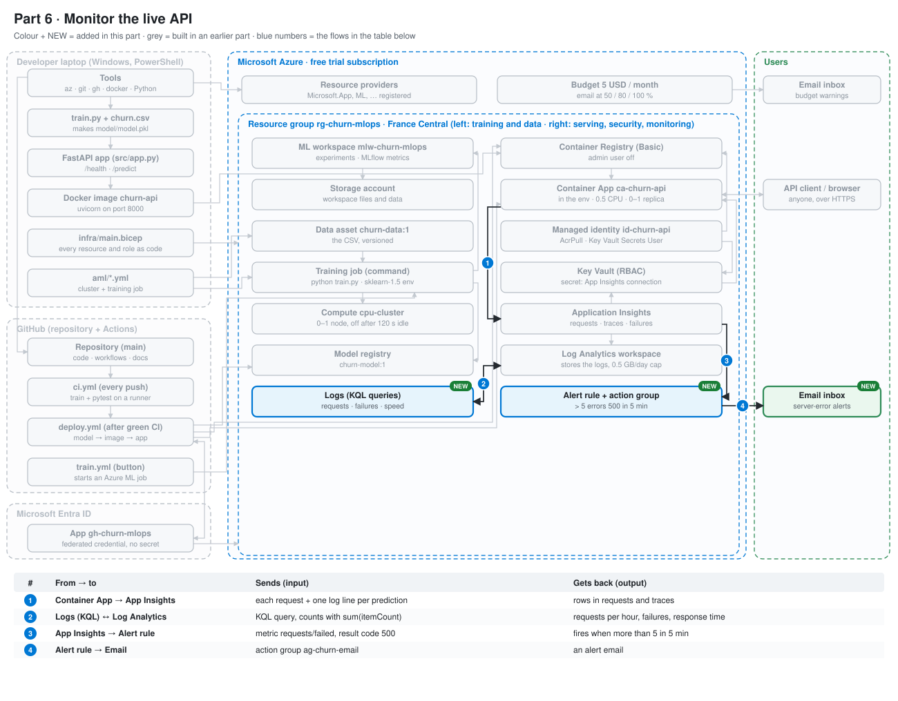
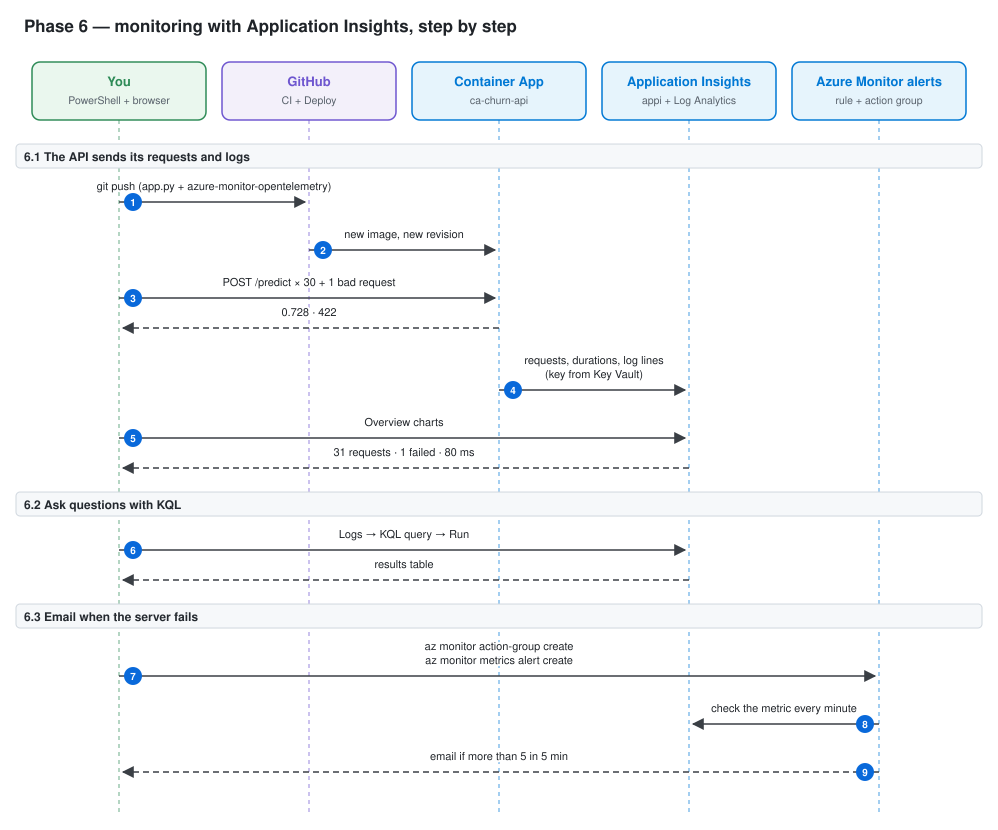
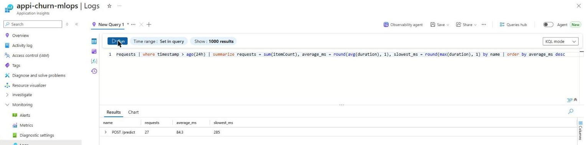
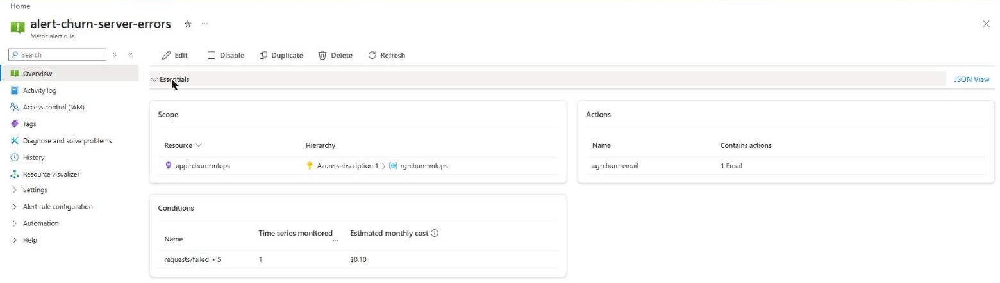

# Phase 6 — Monitoring with Application Insights

Goal: see what the live API does. Every request, its speed and its errors go to **Application Insights**. We read them with **KQL** queries and get an email when too many errors happen.

The resources already exist since Phase 2 ([infra/main.bicep](../../infra/main.bicep)):

- `log-churn-mlops`: the Log Analytics workspace, where the data is stored
- `appi-churn-mlops`: Application Insights, which reads and shows that data
- the Key Vault secret `appinsights-connection-string`, given to the Container App as the setting `APPLICATIONINSIGHTS_CONNECTION_STRING`

So this phase is mostly code and queries. No new paid resource is needed.

---

## Where this phase fits

The system so far. Coloured boxes marked NEW are added in this phase, grey ones come from earlier phases, and the table under the picture says what each numbered arrow sends and gets back.



---

## Architecture of this phase



Read it from top to bottom. Each box at the top is a tool or a service; the dashed line under it is its timeline. Each blue number is one arrow = one call over the network. Solid arrow = a request; dashed arrow = the answer or an automatic message. The table has one row per number.

| # | Command | Tool called | Sends | Gets back |
|---|---|---|---|---|
| | **6.1  The API sends its requests and logs** | | | |
| 1 | `git push` | git → GitHub | new app.py + requirements-api.txt | CI, then Deploy start |
| 2 | — (automatic, deploy.yml) | runner → ACR → Container Apps | new image | new revision with monitoring on |
| 3 | `Invoke-RestMethod -Method Post -Uri "$API/predict" …` | PowerShell → live API | customer JSON | 30 × 0.728, 1 × 422 |
| 4 | — (automatic, inside the app) | app → Application Insights (HTTPS) | requests, durations, log lines | stored in log-churn-mlops |
| 5 | Portal → appi-churn-mlops → Overview | browser → portal | — | charts: requests, failures, response time |
| | **6.2  Ask questions with KQL** | | | |
| 6 | Portal → appi-churn-mlops → Logs → paste a query from docs/kql/ → Run | browser → Log Analytics | KQL text | a results table |
| | **6.3  Email when the server fails** | | | |
| 7 | `az monitor action-group create … / az monitor metrics alert create …` | az CLI → Azure Monitor | email + rule: requests/failed (code 500) > 5 in 5 min | action group + alert rule ($0.10/month) |
| 8 | — (automatic) | Azure Monitor → Application Insights | metric query | failed requests with code 500 |
| 9 | — (automatic) | Azure Monitor → email | alert details | an email to you |

---|---|---|---|---|
| | **6.1  The API sends its data** | | | |
| 1 | `git push` | git → GitHub | new app.py + requirements-api.txt | CI, then Deploy start |
| 2 | — (automatic, deploy.yml) | runner → ACR → Container Apps | new image | new revision with monitoring on |
| 3 | `Invoke-RestMethod -Method Post -Uri "$API/predict" …` (30 times + 1 bad) | PowerShell → live API | customer JSON | 30 × `0.728`, 1 × `422` |
| 4 | — (automatic, inside the app) | app → Application Insights (HTTPS) | requests, durations, log lines | stored in `log-churn-mlops` |
| 5 | Portal → `appi-churn-mlops` → Overview | browser → portal | — | charts: requests, failures, response time |
| | **6.2  Ask questions with KQL** | | | |
| 6 | Portal → `appi-churn-mlops` → Logs → paste a query from docs/kql/ → Run | browser → Log Analytics | KQL text | a results table |

---

## 6.1 The app sends requests and logs to Application Insights

### The code

Three lines in [src/app.py](../../src/app.py) switch monitoring on:

```python
if os.getenv("APPLICATIONINSIGHTS_CONNECTION_STRING"):
    from azure.monitor.opentelemetry import configure_azure_monitor

    configure_azure_monitor(logger_name="churn-api")
```

- `configure_azure_monitor()` comes from the package `azure-monitor-opentelemetry` (added to [requirements-api.txt](../../requirements-api.txt), version 1.8.11). It records every web request automatically: path, status code and duration.
- It must run **before** `from fastapi import FastAPI`. It replaces the FastAPI class with a version that records requests. If FastAPI is imported first, nothing is recorded.
- The `if` means: monitoring only starts when Azure gives the connection string. On the laptop and in CI the setting does not exist, so the tests run without sending anything.
- `logger_name="churn-api"`: only our own log lines are sent, not the noise of every library.

One log line is written per prediction, with only the result (no customer data):

```python
logger.info("prediction churn_probability=%.3f", probability)
```

**No key in the code:** the connection string lives in Key Vault. The Container App reads it with its managed identity and gives it to the app as an environment variable (set up in Bicep in Phase 2).

Test before pushing (in a clean Python 3.12 environment with `requirements-api.txt`):
- without the setting: `pytest` → `3 passed`
- with a fake setting: the app type became `_InstrumentedFastAPI` (monitoring on), and `/health` still answered `{'status': 'ok'}`

### Deploy

```powershell
git add src/app.py requirements-api.txt docs/cost/COST_LOG.md
```

```powershell
git commit -m "Send API requests and logs to Application Insights"
```

```powershell
git push
```

```
To https://github.com/ubaidur404786/azure-churn-mlops.git
   973634d..7392f99  main -> main
```

The push starts CI. After a green CI, Deploy starts by itself.

```powershell
gh run watch --repo $GH_REPO $(gh run list --repo $GH_REPO --workflow deploy.yml --limit 1 --json databaseId -q ".[0].databaseId")
```

```
Run Deploy (38236964124) has already completed with 'success'
```

**Watch out:** this was the **old** deploy run (from the previous commit). CI was still running, so the new Deploy did not exist yet. Wait until CI is finished, then run the command again. The new run:

```
✓ deploy in 2m33s (ID 114776519868)
  ✓ Download the registered model
  ✓ Build the image
  ✓ Test the image
  ✓ Push the image to ACR
  ✓ Update the Container App
  ✓ Check the live API
```

The ANNOTATIONS line "The ubuntu-latest label will migrate to Ubuntu 26" is a notice from GitHub, not an error.

### Send test traffic

```powershell
$API = "https://ca-churn-api.yellowcliff-1636b7fd.francecentral.azurecontainerapps.io"
```

```powershell
$BODY = '{"tenure":2,"MonthlyCharges":85.5,"TotalCharges":171,"SeniorCitizen":0,"Contract":"Month-to-month","InternetService":"Fiber optic","PaymentMethod":"Electronic check","PaperlessBilling":"Yes"}'
```

```powershell
1..30 | ForEach-Object { (Invoke-RestMethod -Method Post -Uri "$API/predict" -ContentType "application/json" -Body $BODY).churn_probability }
```

Output: `0.728` thirty times.

One bad request on purpose (empty customer), so there is a failure to find later:

```powershell
Invoke-RestMethod -Method Post -Uri "$API/predict" -ContentType "application/json" -Body '{}'
```

Output: a red error `422 Unprocessable Entity`. The API refuses a customer with missing fields. Application Insights counts every answer with a status code of 400 or more as a failed request.

### Result in the portal

Portal → Application Insights → `appi-churn-mlops` → Overview, "Show data for last: 1 hour". The data appeared after a few minutes:

| Chart | Value |
|---|---|
| Server requests | 31 |
| Failed requests | 1 (the 422) |
| Server response time (average) | 79.77 ms |

Before the screenshot, close the **Essentials** panel (click its title): it shows the subscription ID, the instrumentation key and the connection string.


The response time here (about 80 ms) is the time **inside** the app. The times measured from the laptop in Phase 3 (200–400 ms) also include the internet trip to France Central.

---

## 6.2 Three KQL queries

KQL (Kusto Query Language) reads the data that Application Insights stores. Each query starts from a table (`requests` = one row per web request) and passes it through steps joined by `|`, like a pipe in PowerShell.

The queries are saved in [docs/kql/](../kql/):

| File | Question it answers |
|---|---|
| [requests_per_hour.kql](../kql/requests_per_hour.kql) | How busy was the API, hour by hour? |
| [failed_requests.kql](../kql/failed_requests.kql) | Which requests failed, when, and with which code? |
| [average_response_time.kql](../kql/average_response_time.kql) | How fast is each endpoint, on average and at worst? |

**How to run one:** Portal → Application Insights → `appi-churn-mlops` → Monitoring → **Logs**.

1. Close the "Welcome" and "Queries hub" windows.
2. The page may open in **Agent** mode (an AI chat). Switch the **Agent** toggle (top right) off, and click **Discard** (it only drops the empty chat).
3. Close the small tour, and change **Simple mode** to **KQL mode** (top right).
4. Paste the query, then click **Run**.

### The sampling surprise

The first version of `requests_per_hour.kql` used `count()`:

```kusto
requests
| where timestamp > ago(24h)
| summarize requests = count() by bin(timestamp, 1h)
```

| timestamp [UTC] | requests |
|---|---|
| 10/12/2026, 10:00:00 AM | 14 |

But we sent 31 requests, and the Overview chart said 31. A check query:

```kusto
requests
| where timestamp > ago(24h)
| summarize rows = count(), real_requests = sum(itemCount) by name, resultCode
```

| name | resultCode | rows | real_requests |
|---|---|---|---|
| POST /predict | 200 | 13 | 26 |
| POST /predict | 422 | 1 | 1 |

**Cause:** the Azure Monitor package keeps only a **sample** of the requests when many arrive per second (here, half of them). Each stored row has an `itemCount` column, the number of real requests it stands for (here 2). The Overview charts use pre-counted numbers, so they are not affected.

**Fix:** count with `sum(itemCount)`, not `count()`. Both count queries now do this. Averages (`avg(duration)`) stay correct, because the sample is random. The totals are estimates (27 here, against 30 + 1 real requests).

### Results

**Failed requests** ([failed_requests.kql](../kql/failed_requests.kql)):

| timestamp [UTC] | name | resultCode | duration (ms) |
|---|---|---|---|
| 10/12/2026, 10:56:57 AM | POST /predict | 422 | 32 |

That is the bad request we sent on purpose (empty customer).

**Average response time** ([average_response_time.kql](../kql/average_response_time.kql)):

| name | requests | average_ms | slowest_ms |
|---|---|---|---|
| POST /predict | 27 | 84.3 | 285 |



---

## 6.3 An alert rule: email when the server fails

Two objects in Azure Monitor:

- **Action group** `ag-churn-email`: *who* is told and *how* (here: one email). Free up to 1,000 emails a month.
- **Metric alert rule** `alert-churn-server-errors`: *when* to tell them. It checks the Application Insights metric `requests/failed` every minute. If more than 5 failed requests with code **500** happen in 5 minutes, it calls the action group. About $0.10 a month.

Why only code 500? A `422` (like our test) is the caller's mistake, not a server problem. A `500` means our own code crashed. Without the filter, any caller sending bad data could flood your inbox.

Names are in [scripts/names.ps1](../../scripts/names.ps1) (`$ACTION_GROUP`, `$ALERT`).

```powershell
$APPI_ID = az resource show --resource-group $RG --name $APPI --resource-type Microsoft.Insights/components --query id -o tsv
```

Output: nothing (`$APPI_ID` holds the full resource id of Application Insights).

Put your email in a variable, for this terminal only (never in a file or in Git):

```powershell
$EMAIL = "YOUR_EMAIL"
```

**Error met:** the first try put the placeholder straight into the command (`--action email me YOUR_EMAIL`):

```
(EmailAddressIsNotValid) EmailAddressIsNotValid
Code: EmailAddressIsNotValid
```

Nothing was created. Fix: the `$EMAIL` variable above, with the real address.

```powershell
az monitor action-group create --resource-group $RG --name $ACTION_GROUP --short-name churnmail --action email me $EMAIL --tags $TAGS feature=monitoring --query "{name:name, enabled:enabled, location:location}" -o table
```

```
Name            Enabled    Location
--------------  ---------  ----------
ag-churn-email  True       Global
```

- `--short-name` (max 12 characters) is shown in the email and SMS.
- `--action email me $EMAIL`: action type `email`, action name `me`, address.
- Action groups are always `Global` (not tied to a region).

```powershell
az monitor metrics alert create --resource-group $RG --name $ALERT --scopes $APPI_ID --condition "count requests/failed > 5 where request/resultCode includes 500" --window-size 5m --evaluation-frequency 1m --severity 2 --action $ACTION_GROUP --description "More than 5 server errors (500) in 5 minutes" --tags $TAGS feature=monitoring --query "{name:name, enabled:enabled, severity:severity, window:windowSize}" -o table
```

```
line 1:39 mismatched input '/' expecting WHITESPACE
Name                       Enabled    Severity    Window
-------------------------  ---------  ----------  --------
alert-churn-server-errors  True       2           PT5M
```

- `--condition`: aggregation `count`, metric `requests/failed`, threshold `> 5`, and a filter on the dimension `request/resultCode`.
- `--window-size 5m`: look at the last 5 minutes. `PT5M` is the same in ISO 8601 format.
- `--evaluation-frequency 1m`: check every minute.
- `--severity 2`: "Warning" (0 = critical … 4 = verbose).

The line `mismatched input '/'` is a warning from the CLI's condition parser: it trips on the `/` in `request/resultCode`. The rule was still created. To be sure the filter was kept:

```powershell
az monitor metrics alert show --resource-group $RG --name $ALERT --query "criteria.allOf[0].{metric:metricName, operator:operator, threshold:threshold, filter:dimensions}" -o json
```

```json
{
  "filter": [
    {
      "name": "request/resultCode",
      "operator": "Include",
      "values": [
        "500"
      ]
    }
  ],
  "metric": "requests/failed",
  "operator": "GreaterThan",
  "threshold": 5.0
}
```

The filter is there: only code 500 counts.

**By hand in the portal:** Application Insights → `appi-churn-mlops` → Monitoring → Alerts → **+ Create** → Alert rule → Signal **Failed requests** → Split by / filter **Result code = 500** → Threshold Static, Greater than 5, aggregation Count, check every 1 minute, lookback 5 minutes → Actions: **+ Create action group** → Notifications: Email → your address → Details: severity 2 - Warning, name `alert-churn-server-errors` → Review + create.

**Result in the portal:** Monitor → Alerts → Alert rules → `alert-churn-server-errors`. Close **Essentials** first, because it shows the subscription ID.



The portal shows the estimated cost of the condition: **$0.10 per month**.

---

## Cost of Phase 6

| What | Cost |
|---|---|
| Application Insights + Log Analytics ingestion | free (first 5 GB a month; we send a few MB) |
| Action group (email) | free (first 1,000 emails a month) |
| Metric alert rule (1 time series) | about $0.10 a month |
| New image in ACR | included in ACR Basic (~€0.16/day, since Phase 2) |

Cost snapshot at the end of Phase 6: €175.96 credit left (portal), about €0.03 spent so far. Cost data arrives 8–48 h late.

## Commit

```powershell
git add .
```

```powershell
git status --short
```

```powershell
git commit -m "Phase 6: monitoring with Application Insights, KQL and an alert rule"
```

```powershell
git push
```
